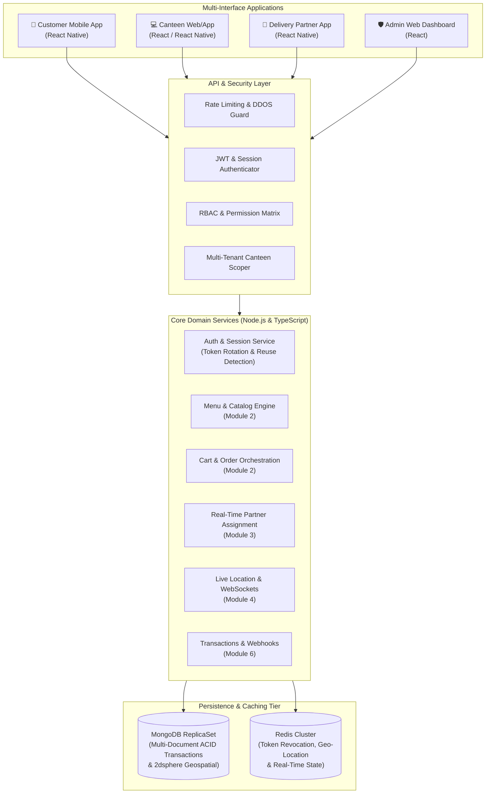

# 🍕 Zlice — Hyperlocal Campus Food Delivery & Real-Time Tracking Platform

A production-grade, multi-sided campus food delivery platform connecting **Customers**, **Canteens**, and **Delivery Partners** through unified web and mobile applications, powered by an enterprise Node.js/TypeScript backend with MongoDB and Redis.

---

## 🏗️ System Architecture



---

## 🚀 Modules Roadmap

- [x] **Module 1: Multi-Role Authentication, RBAC, Multi-Device Sessions & Multi-Tenant Data Isolation**
- [x] **Module 2: Food Catalog, Cart & High-Integrity Order Management**
- [x] **Module 3: Real-Time Geospatial Delivery Partner Assignment Engine**
- [x] **Module 4: Real-Time Live Tracking (WebSockets + Redis PubSub + Geo Stream)**
- [x] **Module 5: Multi-Interface Unified Contract Architecture (Customer, Canteen, Delivery, Admin)**
- [x] **Module 6: Enterprise Payments, Idempotent Webhooks & Transaction Reconciliation**

---

## 🧪 Module 1 Verification

Run the verification test suite:
```bash
cd backend
pnpm exec tsx scripts/verify-auth-flow.ts
```
