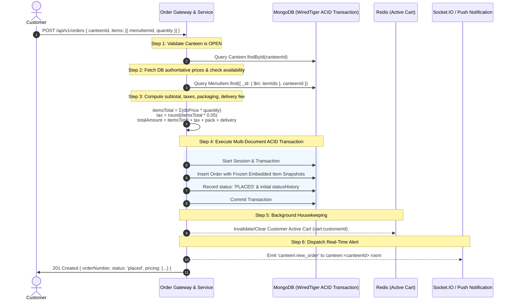
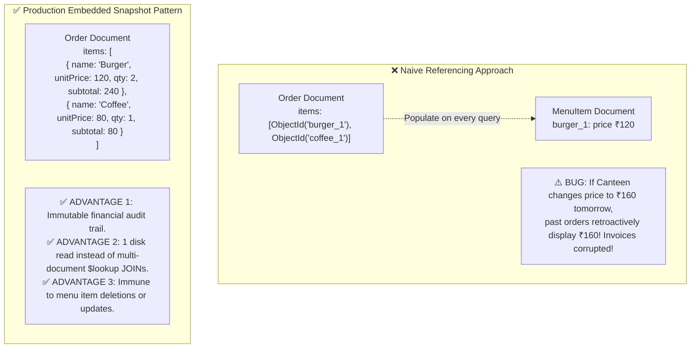
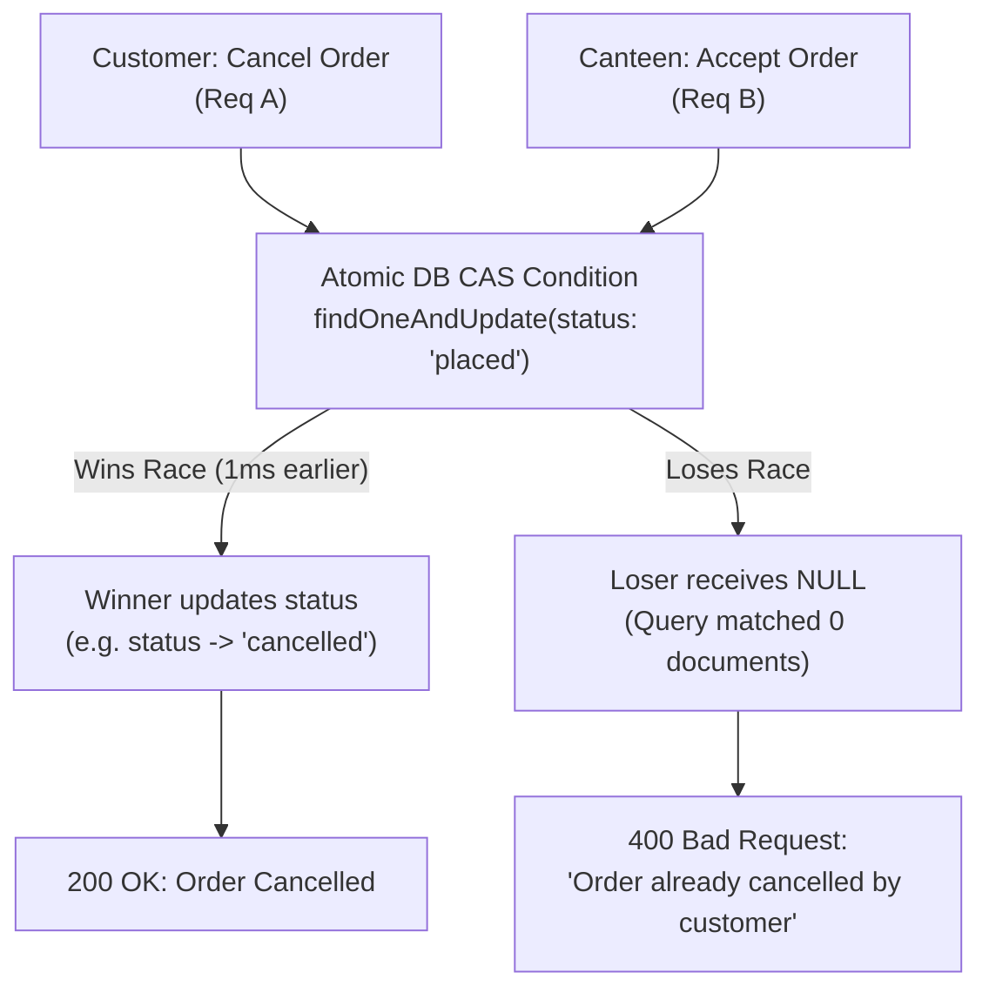

# 🎓 Zlice Module 2: Food Catalog, Cart & High-Integrity Order Management
## Enterprise Interview Mastery Guide (Big Tech / FAANG / High-Scale Hyperlocal Delivery)

---

## 📌 Executive Summary

Order placement and catalog management form the **financial and operational core** of any hyperlocal commerce engine (DoorDash, Swiggy, Zomato, Uber Eats). 

While junior developers treat order creation as a simple database `INSERT`, top-tier engineering organizations evaluate candidates on their mastery of **data consistency, server-authoritative pricing, state machine transitions, concurrent race condition resolution, and MongoDB aggregation mechanics**.

---

## 🚨 QUESTION 1: THE SERVER-AUTHORITATIVE PRICING ENGINE

### ❓ The Interviewer's Question:
> *"A customer opens the Zlice mobile app, adds 2 burgers and 1 cold coffee to their cart, and hits 'Place Order'. Trace the exact end-to-end lifecycle on the backend. How do you guarantee the customer cannot manipulate the price?"*

---

### ❌ The Junior / Naive Approach (Security Catastrophe):
> *"The frontend calculates the total price: 2 burgers at ₹120 each + 1 coffee at ₹80 = ₹320 + ₹51 fees = ₹371. The mobile app sends `{ items: [...], totalAmount: 371 }` to `POST /api/v1/orders`, and the backend saves it."*

**Why this fails immediately in production:**
- **Zero Trust Architecture Violation**: A malicious user intercepts the HTTP request using Postman, Charles Proxy, or Burp Suite, modifies `totalAmount: 1.00`, and submits the order.
- If the backend trusts client-sent prices, the canteen fulfills a ₹371 meal for ₹1, bankrupting the platform.

---

### 🏆 The Enterprise / MNC Architectural Answer:



#### The 6 Invariants Enforced by the Pricing Engine:
1. **Canteen Operating State**: Asserts `canteen.isOpen === true`. If the canteen is closed or temporarily paused due to kitchen rush, the order is rejected.
2. **Tenant Scoping on Items**: Verifies that every `menuItemId` in the request belongs strictly to the target `canteenId`.
3. **Real-Time Stock Availability**: Asserts `menuItem.isAvailable === true`. If the kitchen marked the cold coffee "Sold Out" 10 seconds ago, the order fails with `400 BAD_REQUEST: Item is sold out`.
4. **Server-Side Arithmetic**: Unit prices, item subtotals, tax brackets (5% GST), packaging fees, and delivery surcharges are fetched and summed solely on the server.
5. **Frozen Embedded Snapshots**: Prices are frozen into the `order.items` sub-document array at purchase time.
6. **Asynchronous Cart Clearing & Canteen Notification**: Customer cart in Redis is evicted and an event is published to notify the canteen kitchen dashboard.

---

### 🔥 Big Tech Follow-Up 1.1:
> *"What happens if the customer double-clicks the 'Place Order' button in the mobile app, or a network timeout causes their phone to retry the POST request 500ms later? How do you prevent two identical orders from being created and charged twice?"*

#### The Senior Response:
This requires **Idempotency Keys**:
1. **Client-Generated UUID**: When the checkout screen loads, the mobile app generates a unique `idempotencyKey = UUIDv4()` and sends it in the HTTP header: `Idempotency-Key: 7b2a9e14-fa28-485c-8df2-5d9841029190`.
2. **Distributed Redis Lock / Atomic Set**:
   - The server executes: `SET "idempotency:order:" + key "IN_PROGRESS" NX EX 120` (atomic check-and-set with 120-second TTL).
   - If the key already exists:
     - If status is `"IN_PROGRESS"`, the concurrent request is rejected with `409 Conflict: Order processing in progress`.
     - If the key contains the cached response payload from the first completed request, the server returns the cached `201 Order Created` response immediately without creating a duplicate order!
3. **Database Unique Constraint**: As an additional layer, the Order schema can enforce a unique index on `{ customerId: 1, idempotencyKey: 1 }`.

---

## 🗄️ QUESTION 2: EMBEDDING VS REFERENCING IN MONGODB

### ❓ The Interviewer's Question:
> *"In your MongoDB schema design, why did you embed order item snapshots inside the Order document instead of referencing the `MenuItem` collection? What are the tradeoffs?"*

---

### 🏆 The Enterprise / MNC Architectural Answer:

In MongoDB, document modeling follows access patterns and transactional lifecycles:



#### Why We Embed `items` (The Historical Snapshot Pattern):
1. **Financial & Accounting Immutability**:
   - An order is a legal contract. If a customer ordered a burger for ₹120 on Monday, and the canteen raises prices to ₹160 on Tuesday, the Monday invoice, receipt, and tax calculation must forever reflect ₹120.
   - If you only stored a reference (`menuItemId`), populating the item would either return the updated price or break if the item was deleted from the catalog.
2. **Read Performance (Query Locality)**:
   - When a customer views their receipt or the canteen kitchen views an incoming order ticket, 100% of the required data (item names, quantities, notes, unit prices) is retrieved in **a single sequential disk read**.
   - No costly `$lookup` (JOIN) queries are required across collections.

#### Why We Reference `customerId` and `canteenId`:
- **Cardinality & Document Growth Antipattern**:
  - Embedding all orders inside the `User` or `Canteen` document is a catastrophic antipattern.
  - A popular canteen can receive 50,000 orders per month. MongoDB documents have a **hard limit of 16 MB** (BSON maximum size). Embedding orders in the canteen document would hit this limit and corrupt the collection.
  - Therefore, `Order` is a standalone collection referencing `canteenId` and `customerId`.

---

## ⚡ QUESTION 3: MONGODB MULTI-DOCUMENT ACID TRANSACTIONS

### ❓ The Interviewer's Question:
> *"How do ACID transactions work in MongoDB? What storage engine enables them, and what are the operational performance tradeoffs compared to single-document atomic operations?"*

---

### 🏆 The Enterprise / MNC Architectural Answer:

#### How MongoDB Implements Multi-Document ACID:
1. **WiredTiger Storage Engine**:
   - Since MongoDB 4.0 (replica sets) and 4.2 (sharded clusters), multi-document ACID transactions are powered by WiredTiger's write-ahead transaction log and MVCC (Multi-Version Concurrency Control).
2. **Snapshot Isolation**:
   - Transactions run under **Snapshot Read Concern**. All reads inside the transaction observe a point-in-time snapshot of the database, unaffected by uncommitted concurrent writes from other clients.
3. **Write Concern (`w: 'majority'`)**:
   - Committing a transaction ensures that all writes are durably written to the WAL (Write-Ahead Log) of a majority of voting replica set members before acknowledging success, preventing data loss during primary failover.

#### The Tradeoffs (When NOT to Use Transactions):
- **Latency & Lock Contention**: Multi-document transactions acquire locks on modified documents. If a transaction remains open for too long, it causes write stall and high p99 latency.
- **Transaction Lifetime Limit**: By default, a transaction has a maximum lifetime of 60 seconds (`transactionLifetimeLimitSeconds`). Long-running operations must never be put inside a transaction.
- **Single-Document Atomicity First**: If an operation can be modeled within a single document (where all writes are naturally atomic in MongoDB without overhead), that is preferred over multi-document transactions.

---

## 🔄 QUESTION 4: STATE MACHINE DESIGN & CONCURRENCY RACE CONDITIONS

### ❓ The Interviewer's Question:
> *"Consider this race condition: A customer clicks 'Cancel Order' at 1:15:00.000 PM. At the exact same millisecond (1:15:00.005 PM), the canteen kitchen staff clicks 'Accept Order & Start Preparing'. How does your backend prevent both actions from succeeding?"*

---

### 🏆 The Enterprise / MNC Architectural Answer:

This is a classic **Concurrent State Mutation Race Condition**.



#### How Zlice Prevents This (Atomic Compare-And-Swap / Optimistic Locking):
We never perform a naive read-then-write:
```typescript
// ❌ WRONG (Vulnerable to Race Condition):
const order = await Order.findById(orderId);
if (order.status === 'placed') {
  order.status = 'accepted_by_canteen'; // Race condition here!
  await order.save();
}
```

Instead, we use **Atomic Compare-And-Swap (CAS)**:
```typescript
// ✅ SECURE (Atomic state transition):
const updatedOrder = await Order.findOneAndUpdate(
  {
    _id: orderId,
    status: OrderStatus.PLACED, // PREDICATE: Can ONLY accept if currently PLACED!
    canteenId: req.canteenId
  },
  {
    $set: { status: OrderStatus.ACCEPTED_BY_CANTEEN },
    $push: {
      statusHistory: {
        status: OrderStatus.ACCEPTED_BY_CANTEEN,
        timestamp: new Date(),
        updatedBy: req.user.userId
      }
    }
  },
  { new: true }
);

if (!updatedOrder) {
  // If the customer already cancelled it 2ms ago, status is no longer PLACED!
  throw ApiError.badRequest("Cannot accept order: It was already cancelled by the customer.");
}
```

---

## 📊 QUESTION 5: AGGREGATION PIPELINES FOR CANTEEN ANALYTICS

### ❓ The Interviewer's Question:
> *"The canteen owner opens their daily analytics dashboard. They need to see: Total revenue, number of completed orders, cancellation rate, and their Top 5 best-selling food items for the past 7 days. How do you compute this efficiently without loading thousands of order documents into Node.js memory?"*

---

### 🏆 The Enterprise / MNC Architectural Answer:

We use a single **MongoDB Aggregation Pipeline with `$facet`**:

```typescript
const metrics = await Order.aggregate([
  // Stage 1: Filter strictly by canteen and date range (Covered by compound index)
  {
    $match: {
      canteenId: new Types.ObjectId(canteenId),
      createdAt: { $gte: startDate }
    }
  },
  // Stage 2: Multi-faceted parallel computation in database engine
  {
    $facet: {
      overview: [
        {
          $group: {
            _id: null,
            totalOrders: { $sum: 1 },
            completedOrders: {
              $sum: { $cond: [{ $eq: ['$status', 'delivered'] }, 1, 0] }
            },
            grossRevenue: {
              $sum: {
                $cond: [{ $eq: ['$status', 'delivered'] }, '$pricing.totalAmount', 0]
              }
            }
          }
        }
      ],
      popularItems: [
        { $unwind: '$items' },
        {
          $group: {
            _id: '$items.name',
            unitsSold: { $sum: '$items.quantity' },
            revenue: { $sum: '$items.subtotal' }
          }
        },
        { $sort: { unitsSold: -1 } },
        { $limit: 5 }
      ]
    }
  }
]);
```

#### Why This Impresses Big Tech Interviewers:
- **Zero Memory Overhead in Node.js**: Computation occurs entirely within the MongoDB database server using C++ native iterators. Only the final aggregated summary JSON (~2 KB) is transferred over the network.
- **Parallel Sub-Pipelines via `$facet`**: Computes the high-level revenue figures and the itemized top-selling rankings in **a single database round-trip**.

---

## 🏎️ QUESTION 6: HIGH-THROUGHPUT INDEXING & THE ESR RULE

### ❓ The Interviewer's Question:
> *"Canteen kitchen screens poll for active orders with `status in ['placed', 'accepted_by_canteen', 'preparing']` sorted by `createdAt DESC`. How do you index this query? What is the ESR rule?"*

---

### 🏆 The Enterprise / MNC Architectural Answer:

#### The ESR (Equality, Sort, Range) Rule:
When designing compound indexes in MongoDB:
1. **E (Equality)**: Fields queried by exact match (`canteenId: abc`) come **first**.
2. **S (Sort)**: Fields used for ordering (`createdAt: -1`) come **second**.
3. **R (Range / In)**: Fields queried by range or sets (`status: { $in: [...] }`) come **third**.

#### Applying ESR to Zlice Canteen Orders:
- Query:
  ```typescript
  Order.find({
    canteenId: "65a1b2c3d4e5",                             // Equality
    status: { $in: ['placed', 'accepted', 'preparing'] }   // Range / Set ($in)
  }).sort({ createdAt: -1 });                              // Sort
  ```
- **Optimal Index**:
  ```typescript
  orderSchema.index({ canteenId: 1, createdAt: -1, status: 1 });
  ```
- **Why this works**:
  MongoDB scans only the index keys for that specific canteen in reverse chronological order, matching candidate statuses without needing an in-memory sort (`Btree` scan with zero disk sort spill).

---

## 📊 Summary Comparison: Junior vs Staff Engineer

| Dimension | Junior Approach | Staff / Enterprise Approach |
| :--- | :--- | :--- |
| **Pricing** | Frontend computes total; server accepts it | Server-authoritative engine re-fetching live DB prices |
| **Cart** | Client manages items in local state | Redis-backed cart with Single-Canteen conflict resolution |
| **Historical Data**| References `menuItemId` directly in order | Frozen embedded item snapshots preserving financial records |
| **Concurrency** | Read-then-write (`findById` $\rightarrow$ `save`) | Atomic Compare-And-Swap (`findOneAndUpdate` with predicate) |
| **Analytics** | Pulls 10,000 orders into Node.js; runs `.map()` | MongoDB Aggregation Pipeline (`$match`, `$facet`, `$unwind`) |
| **Indexing** | Single-field index on `canteenId` | Compound ESR Index (`{ canteenId: 1, createdAt: -1, status: 1 }`) |
