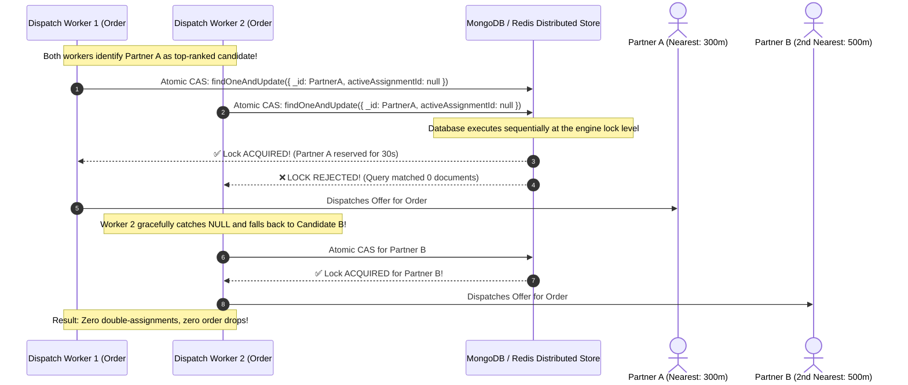
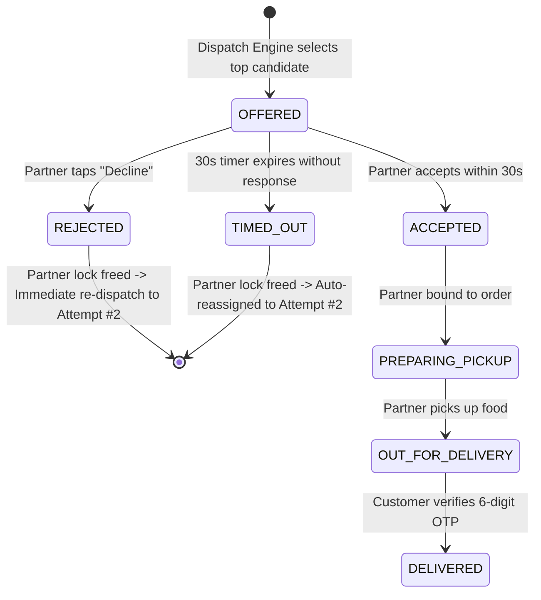

# 🎓 Zlice Module 3: Real-Time Delivery Partner Assignment Engine
## Enterprise Interview Mastery Guide (Big Tech / FAANG / High-Scale Hyperlocal Delivery)

---

## 📌 Executive Summary

The **Real-Time Partner Assignment & Dispatch Engine** is the most complex algorithmic and distributed-systems component in hyperlocal food logistics (Uber Eats, DoorDash, Swiggy, Zomato).

A candidate interviewing for high-level engineering roles must demonstrate mastery over **geospatial querying, distributed concurrency control, atomic reservation locking, multi-factor dispatch heuristics, and fault-tolerant timeout recovery**.

---

## 🚨 QUESTION 1: THE CONCURRENT DOUBLE-ASSIGNMENT CHALLENGE

### ❓ The Interviewer's Question:
> *"Suppose two customers place orders at the exact same millisecond: Order #101 at North Cafeteria, and Order #102 at South Deli. Delivery Partner A is the closest available driver to both canteens. Two asynchronous background dispatch workers pick up these orders simultaneously. How do you guarantee Partner A is NEVER assigned to both orders at the same time?"*

---

### ❌ The Junior / Naive Approach (Race Condition Disaster):
```typescript
// ❌ WRONG: Classic Check-Then-Act Race Condition
const partner = await User.findById(partnerAId);
if (partner.isOnline && !partner.activeOrderId) {
  // ⚡ CONCURRENCY BUG: Worker 1 & Worker 2 reach here at the same millisecond!
  // Both workers see activeOrderId === null!
  await Order.findByIdAndUpdate(orderId, { deliveryPartnerId: partner._id });
  partner.activeOrderId = orderId;
  await partner.save();
}
```

**Why this fails in production:**
- This is a textbook **Check-Then-Act Concurrency Bug** (Time-of-Check to Time-of-Use / TOCTOU).
- Both workers query the database in parallel, see `activeOrderId: null`, and both assign Partner A.
- Partner A receives two contradictory alerts on their phone and is double-booked for two separate pickups in opposite campus directions.

---

### 🏆 The Enterprise / MNC Architectural Answer:

We solve this using **Atomic Compare-And-Swap (CAS) Reservation Locks**:



#### Production Implementation in Zlice:
```typescript
const assignmentId = new Types.ObjectId();
const expiresAt = new Date(Date.now() + 30_000); // 30-second reservation

// ATOMIC CAS RESERVATION IN MONGODB:
const lockedPartner = await User.findOneAndUpdate(
  {
    _id: candidatePartnerId,
    isOnline: true,
    activeOrderId: null,      // Partner must NOT be delivering another order
    $or: [
      { activeAssignmentId: null },          // Not holding an active offer
      { reservedUntil: { $lt: new Date() } } // Or previous reservation expired
    ]
  },
  {
    $set: {
      activeAssignmentId: assignmentId,
      reservedUntil: expiresAt
    }
  },
  { new: true }
);

if (!lockedPartner) {
  // Another worker claimed this partner 1ms earlier!
  // Fall back immediately to the next candidate in the ranked pool.
  return tryNextCandidate();
}
```

#### Redis Distributed Locking Alternative (Redlock):
In hyper-scale environments processing 50,000 dispatches per second:
- Worker executes: `SET "lock:partner:" + partnerId + ":dispatch" workerId NX PX 30000`.
- Only the node acquiring the atomic lock proceeds to create the assignment.

---

### 🔥 Big Tech Follow-Up 1.1:
> *"What happens if Dispatch Worker 1 crashes (e.g. out-of-memory or server reboot) right after acquiring the reservation lock on Partner A? Will Partner A remain locked forever?"*

#### The Senior Response:
- **Time-To-Live (TTL) Leeway**: Notice the lock condition includes `{ reservedUntil: { $lt: new Date() } }`.
- Even if Worker 1 dies abruptly without sending the offer or cleaning up, the lock automatically self-expires after 30 seconds.
- Any subsequent dispatch query after $T+30$s treats the stale lock as expired and automatically reclaims Partner A for new deliveries.

---

## 🗺️ QUESTION 2: GEOSPATIAL QUERYING & 2DSPHERE INDEXES

### ❓ The Interviewer's Question:
> *"How does MongoDB execute geospatial queries? What is the difference between a `2d` and `2dsphere` index, and how would you find all delivery partners within 3 km of a canteen?"*

---

### 🏆 The Enterprise / MNC Architectural Answer:

#### `2d` vs `2dsphere` Indexes:
| Feature | `2d` Index | `2dsphere` Index |
| :--- | :--- | :--- |
| **Geometry** | Flat Euclidean plane ($x, y$). | Spherical Earth model (WGS84 ellipsoid). |
| **Distance Measurement** | Radians on flat coordinate grid. | Actual meters / kilometers on curved surface. |
| **Data Format** | Legacy coordinate pairs `[x, y]`. | GeoJSON standard `{ type: "Point", coordinates: [lng, lat] }`. |
| **Production Fit** | Flat indoor floorplans or game maps. | **Hyperlocal deliveries, GPS tracking, mapping.** |

> [!WARNING]
> In GeoJSON, the coordinate order is **`[longitude, latitude]`** (X then Y), NOT `[lat, lng]`. Inverting this is one of the most common candidate mistakes in mapping interviews.

#### The Geospatial Candidate Query in Zlice:
```typescript
const eligiblePartners = await User.find({
  role: UserRole.DELIVERY_PARTNER,
  isOnline: true,
  activeOrderId: null,
  currentLocation: {
    $near: {
      $geometry: {
        type: "Point",
        coordinates: [canteenLongitude, canteenLatitude] // [lng, lat]
      },
      $maxDistance: 3000 // 3,000 meters = 3 km
    }
  }
}).limit(10);
```

#### How Big Tech Scales Beyond MongoDB Spatial Queries:
- While MongoDB `2dsphere` works well up to tens of thousands of active drivers, companies like Uber, Swiggy, and DoorDash avoid hammering the database with dynamic spatial queries on every dispatch tick.
- **Uber H3 (Hexagonal Hierarchical Spatial Index)**:
  - Divides the planet into a grid of hexagonal cells.
  - Driver GPS coordinates are mapped to an H3 index (e.g. Resolution 8 = ~460m diameter).
  - Searching for nearby drivers becomes an $O(1)$ in-memory hash set lookup in Redis (`kRing` neighbor search) rather than a continuous spherical trigonometry calculation.

---

## ⚖️ QUESTION 3: MULTI-FACTOR DISPATCH HEURISTICS

### ❓ The Interviewer's Question:
> *"In Zlice, Partner A is 300m away on a bicycle. Partner B is 500m away on an e-bike. Partner C is 150m away on foot, but currently delivering another order. A basic algorithm picks A. Why is pure distance insufficient, and how do you design a production dispatch scoring function?"*

---

### 🏆 The Enterprise / MNC Architectural Answer:

#### Why Pure Distance Matching Fails:
1. **Workload Ignorance**: Picking Partner C simply because they are 150m away causes order delays if they are stuck waiting on an active drop-off.
2. **Vehicle Velocity Disparity**: On a sprawling university campus, an e-bike traveling 500m at 25 km/h arrives faster than a walker traveling 250m at 4 km/h.
3. **Driver Churn & Reliability**: If a driver has a 40% acceptance rate (frequently lets timers expire), dispatching to them first wastes 30 seconds of student delivery time.

#### The Zlice Multi-Factor Scoring Formula:
$$\text{Composite Score} = w_1 \cdot S_{\text{dist}} + w_2 \cdot S_{\text{vehicle}} + w_3 \cdot S_{\text{acceptance}} + w_4 \cdot S_{\text{rating}}$$

```typescript
static scoreCandidate(partner: IUser, distanceMeters: number): number {
  // 1. Distance Decay (0.0 to 1.0): 1000m gives 0.5, 300m gives 0.77
  const distFactor = 1000 / (1000 + distanceMeters);

  // 2. Vehicle Speed Multiplier
  let vehicleFactor = 1.0;
  switch (partner.vehicleType) {
    case 'scooter':
    case 'ebike':
      vehicleFactor = 1.25;
      break;
    case 'bicycle':
      vehicleFactor = 1.0;
      break;
    case 'walking':
      vehicleFactor = 0.7;
      break;
  }

  // 3. Historical Reliability Metrics
  const acceptanceFactor = (partner.acceptanceRate || 100) / 100;
  const ratingFactor = (partner.averageRating || 5.0) / 5.0;

  // Composite Weighted Sum
  return Number(
    (0.50 * distFactor +
     0.20 * vehicleFactor +
     0.15 * acceptanceFactor +
     0.15 * ratingFactor).toFixed(4)
  );
}
```

---

## ⏱️ QUESTION 4: ASSIGNMENT TIMEOUTS & REASSIGNMENT WORKERS

### ❓ The Interviewer's Question:
> *"When an offer is dispatched to a delivery partner, they have 30 seconds to accept or reject. If they do nothing, what happens? How does the system transition the state and reassign without stalling the kitchen?"*

---

### 🏆 The Enterprise / MNC Architectural Answer:



#### How Timeout & Reassignment Operates:
1. **The Handshake Contract**:
   - `DeliveryAssignment` is created with `status: OFFERED`, `expiresAt: now + 30s`.
   - Partner mobile app displays an animated 30-second countdown bar.
2. **If Partner Rejects**:
   - Offer immediately transitions to `REJECTED`.
   - The partner's lock is cleared (`activeAssignmentId: null`).
   - The dispatch engine immediately invokes `dispatchOrder(orderId)` again, querying candidate #2 while appending Partner #1 to `rejectedPartnerIds`.
3. **If Partner Times Out (Unresponsive)**:
   - **Background Sweep Worker**: Runs every 5-10 seconds:
     ```typescript
     const expiredOffers = await DeliveryAssignment.find({
       status: DeliveryAssignmentStatus.OFFERED,
       expiresAt: { $lte: new Date() }
     });
     ```
   - For each expired offer:
     - Mark `TIMED_OUT`.
     - Release partner reservation lock.
     - Increment `attemptNumber`.
     - Automatically re-dispatch to the next closest partner.
4. **Max Attempts Guard**:
   - If `attemptNumber > 5`, the automated loop pauses and triggers an escalation alert to the Campus Admin to prevent infinite re-dispatch loops when campus drivers are scarce.

---

## 🔐 QUESTION 5: SECURE HANDSHAKE AT DROP-OFF (THE OTP PATTERN)

### ❓ The Interviewer's Question:
> *"How do you prevent a delivery partner from marking an order 'DELIVERED' before actually reaching the student's dorm room? How do you eliminate false delivery disputes?"*

---

### 🏆 The Enterprise / MNC Architectural Answer:

#### The 6-Digit Cryptographic Handshake (OTP):
1. **Generation on Order Placement**:
   - When the order is created, the backend securely generates a random 6-digit code:
     `order.deliveryOtp = crypto.randomInt(100000, 999999).toString()`.
2. **Access Control**:
   - The `deliveryOtp` is visible **only in the Customer's mobile app** on the active tracking screen.
   - The Delivery Partner app **never receives the OTP in its API responses**.
3. **Physical Handshake**:
   - When the delivery partner arrives at the student's dorm room and hands over the food, the student reads the 6-digit OTP to the partner.
   - The partner types the OTP into their mobile app, which calls:
     `POST /api/v1/delivery/orders/:orderId/deliver { deliveryOtp: "742918" }`.
4. **Server-Side Validation**:
   - The backend validates `order.deliveryOtp === req.body.deliveryOtp`.
   - Only on a strict match does the order transition to `DELIVERED` and release the partner to accept new deliveries.
   - If mismatched, the completion is rejected, eliminating fraudulent drop-off claims.

---

## 📊 Summary Comparison: Junior vs Staff Engineer

| Dimension | Junior Approach | Staff / Enterprise Approach |
| :--- | :--- | :--- |
| **Concurrency** | Read-then-write; double-assigns drivers | Atomic CAS reservation locks in MongoDB (`activeOrderId: null`) |
| **Geospatial** | Euclidean flat distance ($x, y$) | WGS84 `2dsphere` GeoJSON queries + Haversine / Uber H3 |
| **Matching** | Nearest partner by raw distance only | Multi-factor heuristic (Distance + Vehicle speed + Acceptance rate + Rating) |
| **Timeouts** | Frontend setTimeout (fails on backgrounding) | Server-side `expiresAt` with background sweep & auto-reassignment |
| **Rejection** | Order fails or stays stuck | Partner excluded (`rejectedPartnerIds`) and order auto-dispatched to candidate #2 |
| **Drop-off Proof**| Partner clicks "I have delivered" | 6-digit cryptographic OTP handshake entered by partner from customer |
