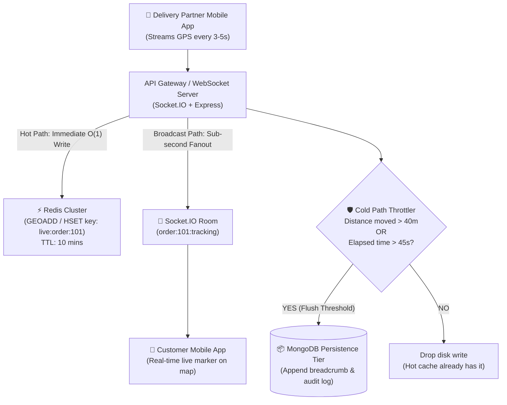
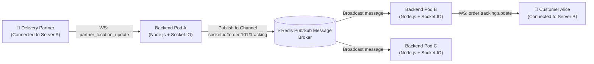
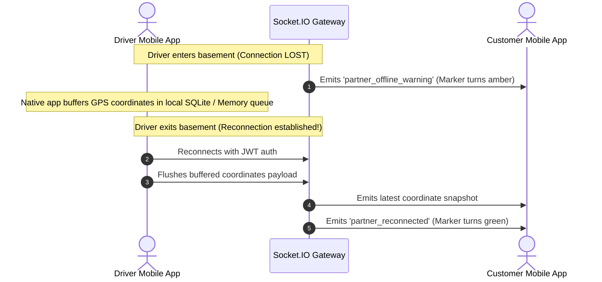

# 🎓 Zlice Module 4: Real-Time Live Tracking Architecture
## Enterprise Interview Mastery Guide (Big Tech / FAANG / High-Scale Hyperlocal Delivery)

---

## 📌 Executive Summary

Real-time live location tracking is the **visual anchor and trust centerpiece** of hyperlocal food delivery apps (DoorDash, Uber Eats, Swiggy, Zomato).

In senior engineering interviews, candidates are judged on how they balance **sub-second streaming latency against database write exhaustion, horizontal WebSocket scaling, mobile battery conservation, and tracking channel security**.

---

## 🚨 QUESTION 1: THE WRITE AMPLIFICATION & INGESTION BOTTLENECK

### ❓ The Interviewer's Question:
> *"Suppose Zlice has 1,000 active delivery partners streaming GPS updates every 3 seconds while out for delivery. That produces ~333 location pings per second. What happens if you write each update directly to MongoDB? How do you architect an ingestion pipeline that protects the database?"*

---

### ❌ The Junior / Naive Approach (Database Meltdown):
> *"Every time the mobile app sends `{ lat, lng }`, the backend executes `User.findByIdAndUpdate(partnerId, { currentLocation: ... })` and `Order.findByIdAndUpdate(orderId, { $push: { breadcrumbs: ... } })`."*

**Why this crashes production in Big Tech:**
- **Disk I/O Choke & Index Thrashing**: Every coordinate update modifies the document and forces a re-index of the `2dsphere` spatial index and B-tree index.
- At 333 writes/sec, MongoDB's WiredTiger cache will be consumed by index dirty pages, triggering massive disk queue stalls and causing customer order checkouts to time out.
- **Document Bloat**: Appending hundreds of raw breadcrumb subdocuments per trip causes continuous document re-allocation on disk.

---

### 🏆 The Enterprise / MNC Architectural Answer:

We implement a **Dual-Tier Hot-Path vs Cold-Path Architecture**:



#### 1. The Hot Path (Sub-Millisecond Read/Write in Memory):
- Incoming coordinates are written strictly to **Redis** (`cache.setex("tracking:live:" + orderId, 600, JSON)` or `GEOADD`).
- Redis executes in single-threaded memory at over **100,000 ops/second** with $< 1\text{ ms}$ latency.
- Simultaneously, Socket.IO fans out the coordinates to everyone subscribed to the order's WebSocket room.

#### 2. The Cold Path (Throttled Persistent Audit Trail in MongoDB):
- Coordinates are persisted to disk in MongoDB **only when a threshold is met**:
  - Distance traveled since last DB flush $> 40$ meters, OR
  - Elapsed time since last DB flush $> 45$ seconds, OR
  - Order state transition occurs (`OUT_FOR_DELIVERY`, `DELIVERED`).
- **Impact**: Reduces disk writes by **over 80%**, preserving database capacity for critical transactions.

---

### 🔥 Big Tech Follow-Up 1.1:
> *"What happens if the customer refreshes their browser or opens the mobile app after it was closed? Does the server hit MongoDB for the initial map render?"*

#### The Senior Response:
- **Cache-Aside Pattern**:
  1. The server checks Redis first: `cache.get("tracking:live:" + orderId)`.
  2. Because the active delivery is streaming updates every 3 seconds, Redis is almost guaranteed a **99.9% cache hit**.
  3. The initial snapshot is served to the client in $< 2\text{ ms}$, rendering the map pins instantly without touching the database.
  4. Only in the rare case of a cache eviction does it fall back to MongoDB.

---

## 📡 QUESTION 2: HORIZONTAL WEBSOCKET SCALING WITH REDIS ADAPTER

### ❓ The Interviewer's Question:
> *"WebSockets maintain persistent TCP connections. In production, you run 5 backend instances behind a cloud Load Balancer. Delivery Partner Rahul is connected to Server A. Customer Alice is connected to Server B. When Rahul emits a location update to Server A, how does Alice receive it in real-time?"*

---

### 🏆 The Enterprise / MNC Architectural Answer:

Without an adapter, Server A only knows about the sockets connected to itself. It cannot communicate with sockets on Server B.



#### How the Socket.IO Redis Adapter Solves This:
1. **Pub/Sub Backplane**:
   - All backend instances connect to a shared Redis cluster using `@socket.io/redis-adapter` (or Redis Streams).
2. **Inter-Node Routing**:
   - When Server A executes `io.to("order:101:tracking").emit("order:tracking:update", data)`, the Redis Adapter intercepts the call and publishes a message to the Redis channel `socket.io#order:101:tracking`.
3. **Cross-Server Delivery**:
   - Server B receives the Pub/Sub packet from Redis, looks up local sockets in room `order:101:tracking`, and delivers the update down Alice's TCP connection.
4. **Load Balancer Configuration (Sticky Sessions)**:
   - The Load Balancer (ALB / Nginx) must use **Cookie-based Sticky Sessions** (or IP Hash) during the initial HTTP upgrade handshake to ensure the polling-to-WebSocket upgrade succeeds before switching to pure WebSocket framing.

---

## 🔒 QUESTION 3: TRACKING CHANNEL SECURITY & EAVESDROPPING PREVENTION

### ❓ The Interviewer's Question:
> *"How do you prevent an attacker from listening in on delivery tracking streams? What stops Customer Eve from connecting to WebSocket room `order:101:tracking` and spying on another student's live location?"*

---

### ❌ The Junior / Flawed Approach:
> *"The frontend simply emits `socket.emit('join_room', orderId)`. As long as they have the order ID, they can join the room."*

**Why this is an OWASP Broken Object Level Authorization (OWASP API1:2023) vulnerability:**
- If an order ID is guessable or leaked, ANY user can track the delivery partner's real-time movements, compromising the driver's physical safety and the student's dorm room location.

---

### 🏆 The Enterprise / MNC Architectural Answer:

We enforce **Two-Layer Cryptographic Access Control**:

```typescript
// LAYER 1: JWT AUTHENTICATION HANDSHAKE
io.use(async (socket, next) => {
  const token = socket.handshake.auth?.token;
  if (!token) return next(new Error("Authentication token required"));
  
  const payload = TokenService.verifyAccessToken(token);
  // Redis session revocation check
  const isRevoked = await TokenService.isSessionRevoked(payload.sessionId);
  if (isRevoked) return next(new Error("Session revoked"));

  socket.data.user = payload; // Attach authenticated identity to socket
  next();
});

// LAYER 2: ROOM-LEVEL AUTHORIZATION CHECK
socket.on('join_order_tracking', async ({ orderId }) => {
  const user = socket.data.user;

  // Verify caller is either:
  // 1. The Customer who placed the order
  // 2. The assigned Delivery Partner
  // 3. The Canteen Owner/Staff fulfilling the order
  // 4. Platform Admin
  await TrackingService.verifyTrackingAccess(orderId, user);

  // Strictly authorized! Allow socket to join channel
  socket.join(`order:${orderId}:tracking`);
});
```

---

## 🔋 QUESTION 4: MOBILE BATTERY, ACCURACY & NETWORK RECONNECTION

### ❓ The Interviewer's Question:
> *"GPS tracking drains mobile phone batteries rapidly, and campus Wi-Fi has frequent dead spots (elevators, basements). How do you handle battery conservation in React Native and manage automatic reconnection?"*

---

### 🏆 The Enterprise / MNC Architectural Answer:

#### 1. Battery Conservation in React Native:
- **Never poll GPS in a tight continuous loop**:
  - Configure native location provider with **Distance Filter** (`distanceFilter: 10` meters). The GPS hardware only wakes up the CPU when the driver has moved at least 10 meters.
  - Set `desiredAccuracy: LocationAccuracy.High` only when actively `OUT_FOR_DELIVERY`; degrade to `Balanced` or `Low` while waiting at the canteen.
- **Foreground Service on Android**:
  - Run as a sticky Android Foreground Service with a persistent notification (`Zlice Delivery Active - Sharing GPS`), preventing the Android OS from killing the background thread.

#### 2. Automatic Reconnection & State Resynchronization:


- **Exponential Backoff with Jitter**:
  When disconnected, the mobile client attempts reconnection at intervals of $1\text{s}, 2\text{s}, 4\text{s}, 8\text{s} \dots$ plus random jitter to avoid a "thundering herd" attack on the API server.

---

## 🏎️ QUESTION 5: DEAD RECKONING & CLIENT-SIDE MAP SMOOTHING

### ❓ The Interviewer's Question:
> *"Because GPS updates arrive every 3 to 5 seconds, a delivery car on a map would appear to freeze and then 'teleport' forward abruptly. How do mapping apps create the illusion of smooth, fluid vehicle movement?"*

---

### 🏆 The Enterprise / MNC Architectural Answer:

This is achieved using **Client-Side Linear Interpolation (Lerp) and Dead Reckoning**:

1. **Linear Interpolation (Lerp)**:
   - When a new GPS coordinate $(x_2, y_2)$ arrives at time $t_2$, the frontend animation loop (using `requestAnimationFrame` in React Native / Google Maps SDK) does not jump the marker.
   - Instead, it smoothly animates the marker from $(x_1, y_1)$ to $(x_2, y_2)$ over a duration of 3,000 ms using an interpolation curve:
     $$P(t) = P_{\text{old}} + (P_{\text{new}} - P_{\text{old}}) \cdot \text{ease}(t)$$
2. **Bearing / Heading Rotation**:
   - The vehicle icon rotates smoothly toward the calculated bearing angle $\theta$ between the two points:
     $$\theta = \text{atan2}(\sin(\Delta \lambda) \cdot \cos(\varphi_2), \cos(\varphi_1) \cdot \sin(\varphi_2) - \sin(\varphi_1) \cdot \cos(\varphi_2) \cdot \cos(\Delta \lambda))$$
3. **Dead Reckoning (Extrapolation during Packet Drops)**:
   - If a GPS update is delayed past 4 seconds due to high network latency, the client estimates the vehicle's next position based on its last known velocity vector and heading angle until the true coordinates arrive.

---

## 📊 Summary Comparison: Junior vs Staff Engineer

| Dimension | Junior Approach | Staff / Enterprise Approach |
| :--- | :--- | :--- |
| **Ingestion** | Directly updates MongoDB on every ping (333 writes/sec) | Dual-tier pipeline: Redis hot-path + throttled MongoDB cold-path |
| **Scaling** | Single Node.js server (fails under cluster) | Socket.IO Redis Adapter for multi-instance Pub/Sub broadcasting |
| **Security** | Unauthenticated rooms or open sockets | JWT handshake auth + Order-level ownership verification before join |
| **ETA** | Fixed distance divided by static speed | Multi-modal campus velocity model (Bike/Scooter/Walk + Building buffer) |
| **Map Rendering**| Marker jumps erratically every 5 seconds | Client-side Linear Interpolation (Lerp) & smooth bearing rotation |
| **GPS Quality** | Trusts any input from mobile phone | Accuracy thresholds ($< 50$m) + teleportation velocity jump detection |
