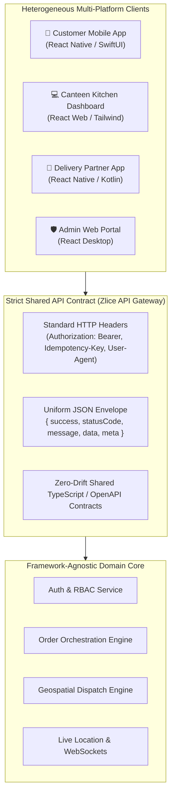
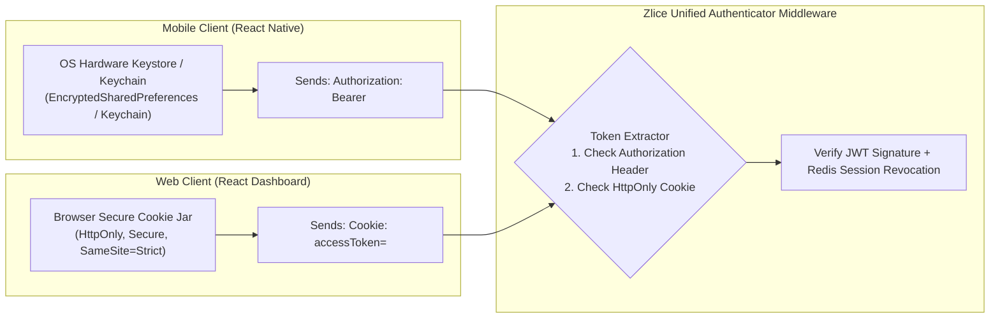

# 🎓 Zlice Module 5: Multi-Interface Application Architecture
## Enterprise Interview Mastery Guide (Big Tech / FAANG / High-Scale Hyperlocal Delivery)

---

## 📌 Executive Summary

One of the definitive hallmarks of a **Staff or Principal Engineer** is the ability to architect an enterprise backend that seamlessly powers **multiple heterogeneous user interfaces** simultaneously without bleeding client-specific logic into domain services.

In Zlice, a single backend cluster powers:
1. **Customer Mobile App** (React Native - iOS & Android)
2. **Canteen Kitchen Dashboard** (React - Desktop / iPad Web)
3. **Delivery Partner Mobile App** (React Native - Android & iOS with background GPS)
4. **Campus Admin Web Portal** (React - Desktop Browser)

Below is the definitive interview guide covering **framework-agnostic design, Backend-for-Frontend (BFF) tradeoffs, cross-platform authentication, mobile deep linking, and optimistic state synchronization**.

---

## 🚨 QUESTION 1: FRAMEWORK-AGNOSTIC BACKEND DESIGN

### ❓ The Interviewer's Question:
> *"Why should a backend API be completely independent of the frontend framework? How does your `/api/v1/orders` endpoint support a React Native mobile app, an iOS native app in Swift, an Android app in Kotlin, and a React web dashboard without any code changes on the server?"*

---

### ❌ The Junior / Naive Approach:
> *"We create separate endpoints: `/api/v1/react-native/orders` for mobile and `/api/v1/react-web/orders` for the web dashboard because web needs more fields than mobile."*

**Why this fails in Big Tech:**
- **Code Duplication & Maintenance Nightmare**: Business logic (tax calculation, canteen validation, stock deduction) is duplicated across client routes. A bug fix in pricing must be applied in multiple places.
- **Tight Coupling**: Any UI redesign forces backend refactoring.
- **SDK Drift**: Native mobile apps cannot share types or automated contracts with the backend.

---

### 🏆 The Enterprise / MNC Architectural Answer:

#### The Protocol-Level Abstraction:
A production backend must operate at the **Domain Protocol Layer** (HTTP/REST, WebSockets, gRPC), completely detached from whether the client uses React, SwiftUI, Jetpack Compose, or Flutter:



#### The 4 Golden Rules of Framework-Agnostic Design:
1. **Contract Over Presentation**: The API returns **data and entity state**, never UI presentation structures (e.g., return `status: "preparing"` and let the client decide whether to render a green pill, a progress bar, or a push banner).
2. **Standardized Enveloping**: Every endpoint adheres to a uniform envelope:
   ```json
   {
     "success": true,
     "statusCode": 200,
     "message": "Order created successfully",
     "data": { "orderId": "...", "status": "placed" },
     "meta": { "timestamp": "2026-11-13T18:00:00Z" }
   }
   ```
3. **Role-Based Projection (Data Masking)**:
   - When a Customer queries the order, the backend includes `deliveryOtp: "849201"`.
   - When the Delivery Partner queries the order, `deliveryOtp` is strictly masked until drop-off.
   - The same endpoint `/api/v1/orders/:orderId` serves both actors safely via RBAC field projection.
4. **Stateless Media Types**: Standard `application/json` payload structures easily deserialized by `Codable` in Swift, `Moshi/Gson` in Kotlin, or `JSON.parse` in JavaScript.

---

## ⚖️ QUESTION 2: BFF (BACKEND-FOR-FRONTEND) VS UNIFIED REST VS GRAPHQL

### ❓ The Interviewer's Question:
> *"When should an enterprise use a Unified REST API, when should it use a Backend-for-Frontend (BFF), and when should it use GraphQL? What are the tradeoffs in hyperlocal delivery?"*

---

### 🏆 The Enterprise / MNC Architectural Answer:

| Architecture | How It Works | Best Used For | Tradeoffs in Hyperlocal Delivery |
| :--- | :--- | :--- | :--- |
| **Unified REST API** (Zlice Core) | Single set of versioned REST endpoints (`/api/v1/*`) shared across all clients with role projection. | Fast MVP, high-throughput transactions, predictable latency, straightforward caching. | Potential slight over-fetching on cellular mobile devices. |
| **BFF** (Backend-for-Frontend) | Dedicated lightweight gateway per client: `customer-bff`, `canteen-bff`, `delivery-bff`. | Large engineering teams where mobile and web teams need independent deployment cadences. | **Operational Overhead**: Multiple backend services to maintain, deploy, and monitor. |
| **GraphQL** | Client specifies exact query fields (`query { order { id total items { name } } }`). | Sprawling read-heavy catalogs with deeply nested relationships. | **Poor CDN caching**, difficult rate limiting, complex query complexity analysis, vulnerable to nested DoS attacks. |

#### Why Zlice Uses Unified REST with Field Projections:
- Food delivery workflows (order placement, state machine transitions, payments) are **transaction-heavy and write-intensive**, not just read-heavy queries.
- REST provides deterministic, predictable latency, easy edge caching with Cloudflare/Akamai, and simple HTTP status code semantics (`201 Created`, `409 Conflict`, `403 Forbidden`).

---

## 🔑 QUESTION 3: CROSS-PLATFORM AUTHENTICATION SYNCHRONIZATION

### ❓ The Interviewer's Question:
> *"Why do web browsers and mobile apps require different token storage mechanisms? How does your backend authentication middleware handle both seamlessly?"*

---

### 🏆 The Enterprise / MNC Architectural Answer:



#### The Client Divergence:
1. **Web Dashboard**:
   - Vulnerable to **XSS** (Cross-Site Scripting).
   - Solution: Store refresh token in **`HttpOnly` cookies**. JavaScript running in the browser cannot access `document.cookie`.
2. **Mobile App**:
   - Mobile apps do not have a native "browser cookie jar" shared across background location threads and push notification handlers.
   - Solution: Store tokens in **hardware-backed secure storage** (`react-native-keychain` using iOS Keychain and Android Keystore with AES-256 GCM). Tokens are passed via the standard `Authorization: Bearer <token>` header.

#### How Zlice Unifies This in One Middleware:
In [authenticate.ts](file:///c:/Users/Mohit/Desktop/Zlice/backend/src/middlewares/authenticate.ts):
```typescript
let token: string | undefined;

// 1. Check Authorization header (Mobile Native / React Native)
if (req.headers.authorization?.startsWith('Bearer ')) {
  token = req.headers.authorization.split(' ')[1];
}
// 2. Check signed/HttpOnly cookie (Web Dashboard)
else if (req.cookies?.accessToken) {
  token = req.cookies.accessToken;
}

if (!token) throw ApiError.unauthorized("Authentication required");
```
Neither mobile nor web requires custom routes — authentication is cleanly decoupled.

---

## 🔗 QUESTION 4: MOBILE DEEP LINKING (UNIVERSAL & APP LINKS)

### ❓ The Interviewer's Question:
> *"A student receives an SMS or Push Notification: 'Your burger is out for delivery! Click here to track.' How does Deep Linking work in React Native, and what happens if the student does not have the app installed?"*

---

### 🏆 The Enterprise / MNC Architectural Answer:

#### 1. Custom Schemes vs Universal Links:
- **Custom Scheme (`zlice://orders/101/track`)**:
  - Registered in mobile `AndroidManifest.xml` and iOS `Info.plist`.
  - Limitation: If the app is not installed, the browser shows an ugly error (*"Cannot open page"*).
- **Universal Links (iOS) & Android App Links**:
  - Uses standard HTTPS URLs: `https://zlice.campus.edu/orders/101/track`.
  - **Cryptographic Domain Proof**:
    - iOS verifies `https://zlice.campus.edu/.well-known/apple-app-site-association`.
    - Android verifies `https://zlice.campus.edu/.well-known/assetlinks.json`.
  - If the app is installed, the OS intercepts the HTTPS click and opens the app natively with zero browser redirect.
  - If the app is NOT installed, the link opens gracefully in the mobile web browser!

#### 2. Deep Link Resolution in Zlice ([customer.client.ts](file:///c:/Users/Mohit/Desktop/Zlice/shared/clients/customer.client.ts)):
```typescript
static parseDeepLink(url: string) {
  const parsed = new URL(url);
  const fullPath = `${parsed.host || ''}/${parsed.pathname.replace(/^\/+/, '')}`.replace(/^\/+/, '');
  const parts = fullPath.split('/');

  if (parts[0] === 'orders' && parts[2] === 'track') {
    return {
      route: 'LiveTrackingScreen',
      params: { orderId: parts[1] }
    };
  }
  return null;
}
```

---

## ⚡ QUESTION 5: REAL-TIME STATE SYNCHRONIZATION & OPTIMISTIC UI

### ❓ The Interviewer's Question:
> *"When a customer taps 'Add to Cart' or a Canteen Owner taps 'Accept Order', how do you manage loading, error, and optimistic state updates across slow cellular networks?"*

---

### 🏆 The Enterprise / MNC Architectural Answer:

#### Optimistic UI Updates:
- Rather than waiting 800ms for a round-trip network response before updating the UI:
  1. **Immediate Local Mutation**: The client state (TanStack Query / Redux Toolkit) immediately renders the order as `ACCEPTED` or increments cart count to 3.
  2. **Background HTTP Dispatch**: The API call fires asynchronously.
  3. **Rollback on Error**: If the server returns `400 BAD_REQUEST: Item is sold out` or network times out, the local UI rolls back smoothly to the previous state and displays a non-intrusive toast alert.

#### Cache Invalidation & Event Sync:
- When a WebSocket event arrives (`order:status:change`), the mobile app invalidates its local query cache key `['order', orderId]`, causing the active screen to fetch fresh server data automatically without requiring manual page reloads.

---

## 📊 Summary Comparison: Junior vs Staff Engineer

| Dimension | Junior Approach | Staff / Enterprise Approach |
| :--- | :--- | :--- |
| **Backend Coupling** | Separate endpoints for web vs mobile (`/mobile/orders`) | Unified framework-agnostic REST endpoints with role projection |
| **Authentication** | Stores tokens in `localStorage` everywhere | Hardware Keystore/Keychain for mobile; HttpOnly Cookie for web |
| **Contract Drift** | Frontend and backend write duplicate interfaces | Shared TypeScript contracts / OpenAPI specs as single source of truth |
| **Deep Linking** | Hardcoded custom URL scheme (breaks if not installed) | Universal / App Links with cryptographic domain verification & web fallback |
| **UI State** | Blocking spinners for every button click | Optimistic UI updates with automatic rollback on network failure |
