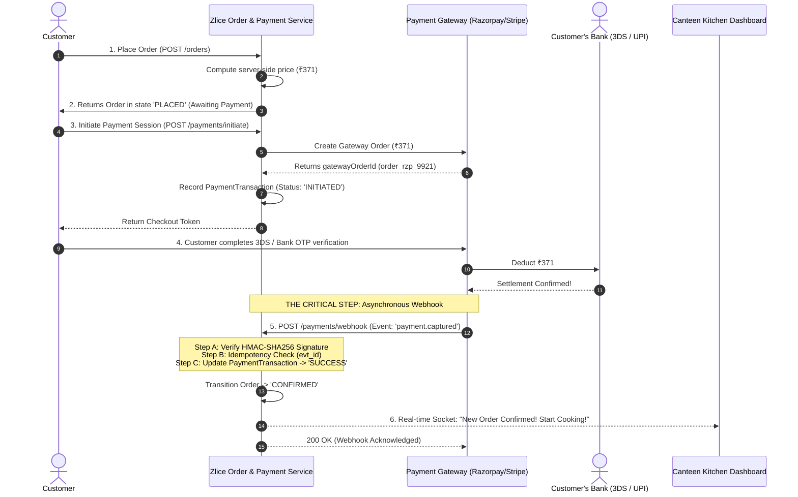
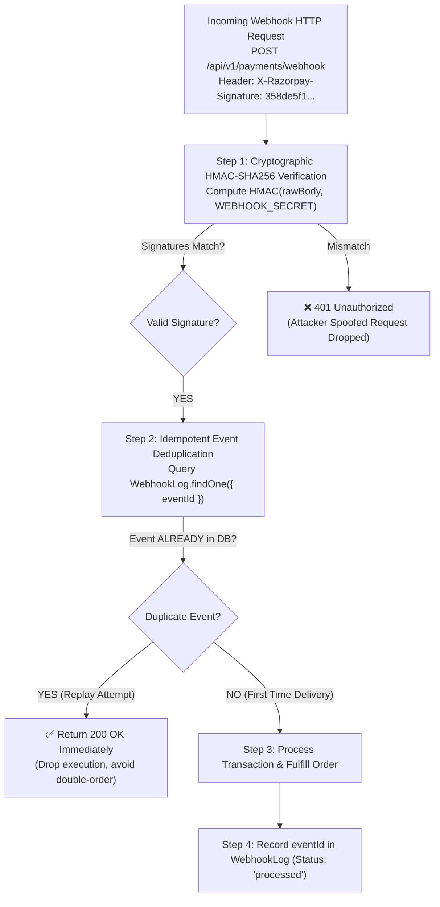

# 🎓 Zlice Module 6: Payments, Transactions & Webhook Management
## Enterprise Interview Mastery Guide (Big Tech / FAANG / High-Scale Hyperlocal Delivery)

---

## 📌 Executive Summary

Payment engineering is the most **financially and legally scrutinized** tier of any consumer platform (DoorDash, Uber, Amazon, Swiggy, Stripe).

In senior engineering interviews, candidates who treat payment as *"just calling `stripe.charges.create()`"* are swiftly filtered out. Top-tier hiring committees look for mastery over **asynchronous eventual consistency, webhook idempotency, replay attack defense, HMAC cryptographic verification, and the decoupled lifecycle of orders versus financial settlement**.

---

## 🚨 QUESTION 1: THE DECOUPLED LIFECYCLE (ORDER CREATION $\ne$ PAYMENT SUCCESS)

### ❓ The Interviewer's Question:
> *"Explain why 'Order Placed' and 'Payment Successful' MUST be modeled as two completely decoupled asynchronous business events. What disastrous consequences occur if an engineer couples them into a single synchronous endpoint?"*

---

### ❌ The Junior / Naive Approach (The Synchronous Payment Trap):
```typescript
// ❌ CATASTROPHIC BUG: Bundling order creation and payment synchronously
app.post('/api/orders/checkout', async (req, res) => {
  const charge = await paymentGateway.chargeCard(req.body.cardToken, req.body.amount);
  if (charge.success) {
    const order = await Order.create({ ...req.body, status: 'placed' });
    res.json({ success: true, order });
  }
});
```

**Why this fails in Big Tech:**
1. **The 3DS (Two-Factor Authentication) Reality**: In modern e-commerce (UPI in India, 3D Secure / SCA in Europe, Apple Pay), payments are **asynchronous multi-step human redirects** requiring OTP verification or biometric approval outside the application. A synchronous HTTP request cannot block the thread waiting 2 minutes for a student to type an SMS OTP.
2. **The "Charged but No Food" Catastrophe**: If `paymentGateway.chargeCard()` succeeds and deducts ₹371, but the subsequent `Order.create()` fails due to a database network timeout or process crash, the customer's money is gone, but no order exists on the server.
3. **The Reverse Failure ("Free Food")**: If the order is created first and the payment call times out, the kitchen begins cooking before payment is settled.

---

### 🏆 The Enterprise / MNC Architectural Answer:

We model Order Orchestration and Payment Settlement as an **Asynchronous State Machine**:



---

## 📱 QUESTION 2: THE DROPPED CONNECTION DILEMMA (APP CRASH AFTER DEBIT)

### ❓ The Interviewer's Question:
> *"A customer enters their OTP, the bank debits ₹371, but before the gateway redirects back to Zlice, the student's phone battery dies or their browser closes. The redirect callback never reaches your server. How does Zlice guarantee the food is cooked and delivered without the customer being charged twice or losing their money?"*

---

### 🏆 The Enterprise / MNC Architectural Answer:

#### The Webhook as the Single Source of Truth (SSOT):
- In production payment architecture, **frontend redirect callbacks are strictly treated as cosmetic UI hints**, NEVER as proof of financial settlement.
- Even if the student throws their phone into the river the microsecond after clicking "Submit OTP", the bank communicates directly with the payment gateway server-to-server.
- The gateway immediately fires an **Asynchronous Webhook (`payment.captured`)** directly to the Zlice backend (`POST /api/v1/payments/webhook`).

#### Guaranteed Delivery & Exponential Backoff:
- If Zlice's server happens to be temporarily rebooting when the webhook arrives, gateways (Stripe, Razorpay, Adyen) do not drop the event.
- They retry the webhook using an **Exponential Backoff Schedule** (e.g., retrying at 1m, 5m, 15m, 1h, 6h, 12h, 24h) until the server acknowledges with an HTTP `200 OK`.
- When the student recharges their phone and re-opens Zlice 10 minutes later, the active order is already marked `CONFIRMED` and `PREPARING` because the webhook settled the transaction independently of the client device.

---

## 🛡️ QUESTION 3: WEBHOOK REPLAY ATTACKS & HMAC SIGNATURE VERIFICATION

### ❓ The Interviewer's Question:
> *"Because webhook endpoints must be public so gateways can reach them without user JWT tokens, how do you prevent an attacker from sending fake `payment.captured` webhooks to get free food? How do you prevent Webhook Replay Attacks?"*

---

### 🏆 The Enterprise / MNC Architectural Answer:

We implement a **Two-Layer Cryptographic Perimeter**:



#### 1. Cryptographic HMAC-SHA256 Signature Verification:
- When configuring the webhook in the gateway dashboard, Zlice and the gateway share an out-of-band secret key (`WEBHOOK_SECRET`).
- The gateway hashes the exact raw request body using HMAC-SHA256 and sends the hex digest in the header (`X-Razorpay-Signature` or `Stripe-Signature`).
- **Critical Requirement (Raw Body)**: In Express, standard `express.json()` parses the stream into an object. We use a buffer hook (`verify: (req, res, buf) => req.rawBody = buf.toString()`) to ensure not a single byte, whitespace, or newline is altered before re-calculating the hash.
- **Timing-Safe Comparison**: We use `crypto.timingSafeEqual` to prevent side-channel timing attacks from leaking secret bytes.

#### 2. Replay Attack & Duplicate Webhook Defense (Idempotency):
- Every gateway webhook carries a globally unique `eventId` (e.g. `evt_3N8eX92eZvKYlo2C1`).
- Before touching the order or payment tables, Zlice checks the `WebhookLog` collection.
- If `eventId` was already processed, the server **immediately returns `200 OK` and exits**.
- This guarantees that even if the gateway retries the webhook 5 times due to network jitter, the customer's order is fulfilled **exactly once**, preventing double food preparation or duplicated ledger credits.

---

## 🔁 QUESTION 4: IDEMPOTENCY KEYS IN PAYMENT INITIATION

### ❓ The Interviewer's Question:
> *"A customer on a spotty cellular connection taps 'Pay Now'. The screen freezes for 2 seconds, so they aggressively tap 'Pay Now' three more times. How does your backend guarantee that three separate payment sessions are not created at the gateway?"*

---

### 🏆 The Enterprise / MNC Architectural Answer:

We use **Client-Generated Idempotency Keys** (IETF Draft / Stripe RFC):

1. **Client Generation**: When the checkout sheet mounts, the client generates a unique `idempotencyKey = "order_" + orderId + "_attempt_" + attemptNumber`.
2. **Database Unique Constraint**:
   ```typescript
   paymentTransactionSchema.index({ idempotencyKey: 1 }, { unique: true });
   ```
3. **Atomic Upsert / Check in Service Layer ([payment.service.ts](file:///c:/Users/Mohit/Desktop/Zlice/backend/src/modules/payments/payment.service.ts))**:
   ```typescript
   const existing = await PaymentTransaction.findOne({ idempotencyKey });
   if (existing) {
     // Return existing gatewayOrderId and checkout token without creating a new session!
     return { transaction: existing, clientPayload: ... };
   }
   ```
4. If two requests hit the server concurrently at the exact same millisecond, MongoDB's unique index constraint aborts the second insert with a duplicate key error (`code: 11000`), ensuring mathematical single-execution.

---

## 💸 QUESTION 5: AUTOMATED REFUND LIFECYCLES ON CANCELLATION

### ❓ The Interviewer's Question:
> *"A student orders dinner, but the canteen is overwhelmed and cancels the order 5 minutes later. How does the refund execute? Walk through the failure modes."*

---

### 🏆 The Enterprise / MNC Architectural Answer:

#### The Refund State Machine:
1. **Cancellation Assertion**:
   - The order transitions to `CANCELLED`.
2. **Transaction Lookup**:
   - The system queries `PaymentTransaction.findOne({ orderId, status: PaymentStatus.SUCCESS })`.
3. **Gateway Refund API Call**:
   - The backend calls the gateway refund endpoint with an `Idempotency-Key: refund_order_101`.
   - The gateway returns a `refundId` (`rfnd_9921aa`).
4. **Audit Immutability**:
   - Transaction transitions to `REFUNDED` with embedded snapshot:
     ```typescript
     transaction.refund = {
       refundId: 'rfnd_9921aa',
       amount: transaction.amount,
       reason: 'Canteen cancelled order due to rush',
       status: 'completed',
       refundedAt: new Date()
     };
     await transaction.save();
     ```

#### Handling Gateway Outages during Refund:
- If the gateway's refund API returns `500 Gateway Error` or times out, the transaction is marked `refund.status = 'pending'`.
- A background reconciliation worker (`CronJob` / Dead-Letter Queue) re-attempts failed refunds every hour using the same idempotency key until confirmed by the bank.

---

## 📊 Summary Comparison: Junior vs Staff Engineer

| Dimension | Junior Approach | Staff / Enterprise Approach |
| :--- | :--- | :--- |
| **Order vs Payment** | Synchronous coupling in a single route | Fully decoupled asynchronous state machine |
| **Settlement Source**| Trusts frontend redirect URL | Gateway Webhook as the definitive Single Source of Truth |
| **Webhook Security** | No auth or simple API key | Cryptographic HMAC-SHA256 signature verification over raw body |
| **Webhook Retries** | Executes logic on every retry (duplicate orders) | Idempotent event logging (`WebhookLog`) returning cached 200 OK |
| **Double Clicks** | Creates multiple charges on gateway | Unique `idempotencyKey` caching previous session |
| **Refunds** | Manual manual bank transfers | Automated gateway refund triggers with retry reconciliation |
