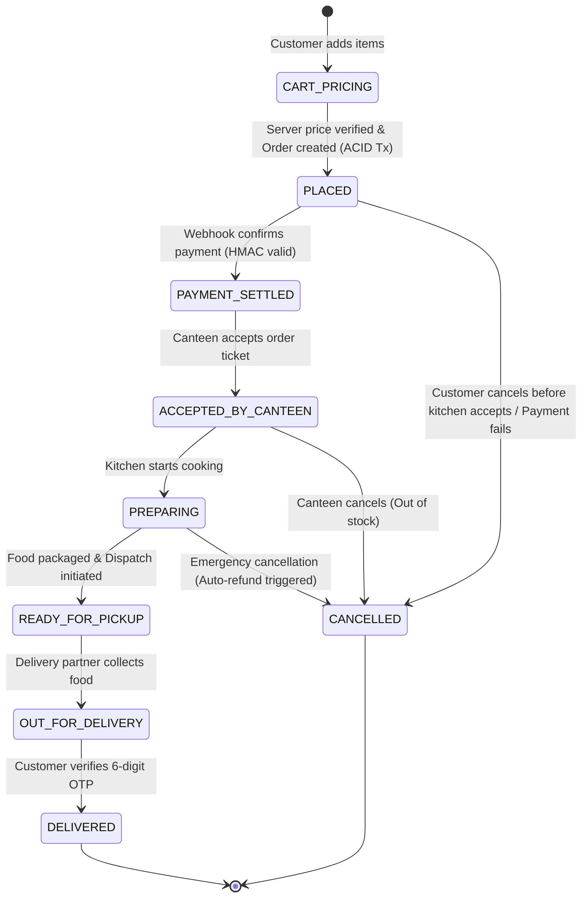
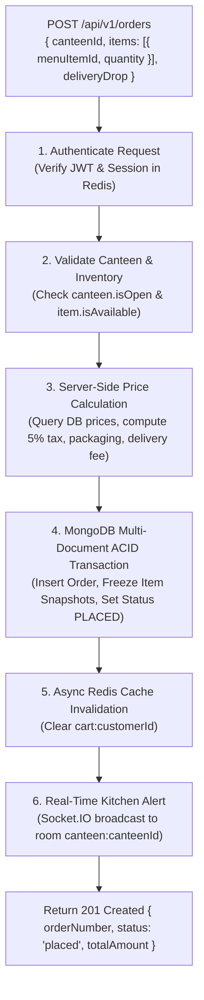
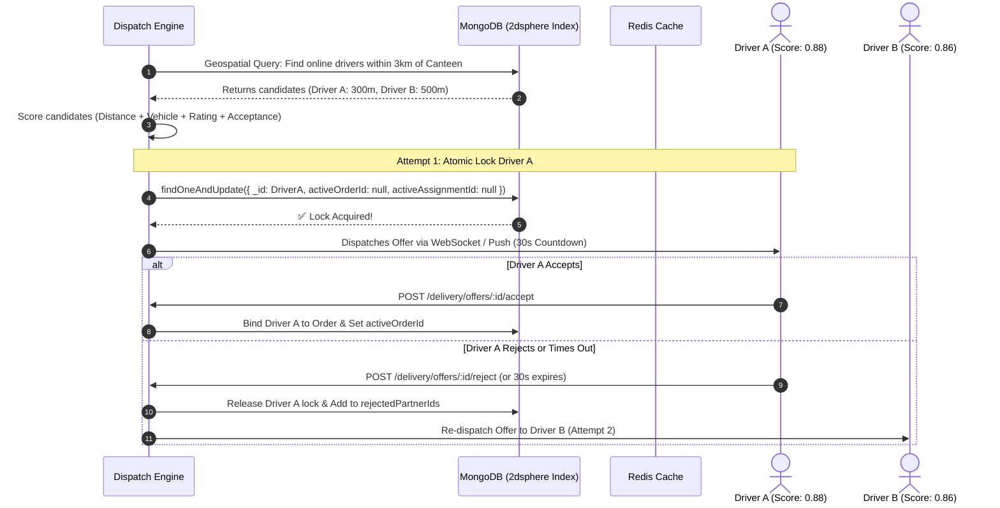
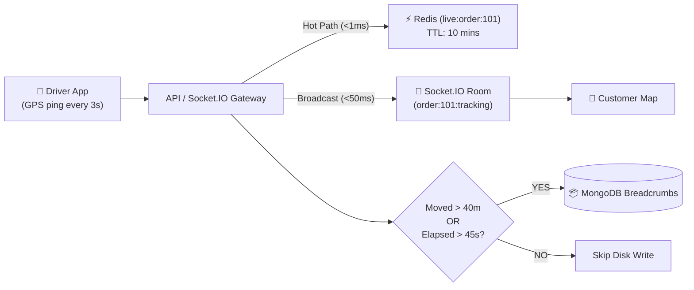
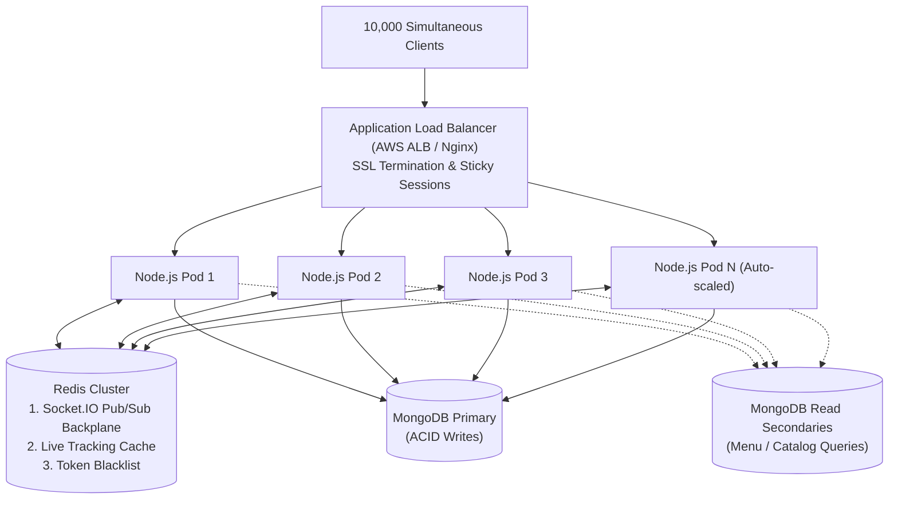
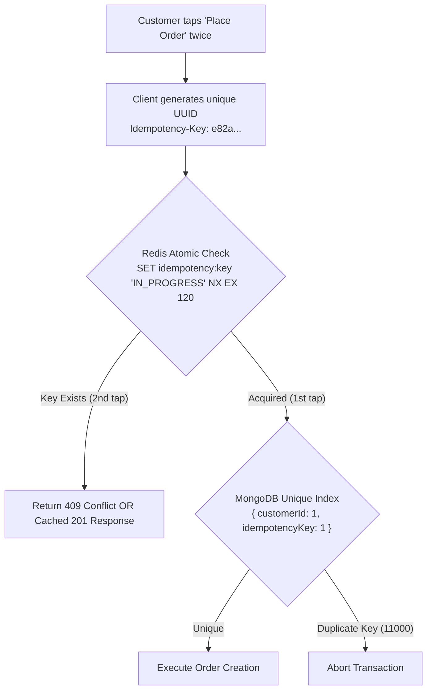

# 🏛️ Zlice: Comprehensive System Design & Engineering Deep Dive (15 Core MNC Questions)

---

## 1. Explain the complete order lifecycle.

The Zlice order lifecycle is governed by a **Deterministic Finite State Machine (FSM)**. It guarantees that orders transition monotonically and forbids illegal state jumps (e.g. jumping from `PLACED` directly to `DELIVERED`).



### The 7 Lifecycle Stages:
1. **Cart & Pricing**: Customer selects items. System validates canteen operating status (`isOpen === true`) and single-canteen cart constraints.
2. **Order Placement (`PLACED`)**: Backend calculates authoritative pricing from database records, creates the order via a **WiredTiger ACID Transaction**, and freezes item price snapshots.
3. **Payment Settlement**: Asynchronous gateway webhook (`payment.captured`) verifies financial transfer via HMAC-SHA256, advancing the order to confirmed status.
4. **Kitchen Acknowledgement (`ACCEPTED_BY_CANTEEN` $\rightarrow$ `PREPARING`)**: Canteen staff accepts ticket on their web dashboard and begins cooking.
5. **Dispatch & Ready (`READY_FOR_PICKUP`)**: Dispatch engine runs a multi-factor geospatial match, reserving the optimal delivery partner for a 30-second handshake.
6. **Transit (`OUT_FOR_DELIVERY`)**: Driver picks up food from canteen; high-frequency GPS tracking streams coordinates to the customer map.
7. **Drop-Off & Verification (`DELIVERED`)**: Driver collects secret 6-digit OTP from student dorm and completes the order.

---

## 2. What happens when a customer places an order?

When a customer taps **"Place Order"**, the backend executes a **6-Step Zero-Trust Transaction Pipeline**:



### Critical Implementation Details:
- **Zero Trust on Prices**: Any client-sent prices or totals are discarded. Prices are fetched directly from MongoDB `MenuItem` records.
- **Embedded Snapshot Pattern**: Names and unit prices are cloned into embedded subdocuments (`order.items`), insulating historical records from future menu price increases.
- **ACID Atomicity**: `session.withTransaction()` guarantees that if writing the order, logging the status history, or creating the initial state fails, the entire operation rolls back cleanly.

---

## 3. How is a delivery partner assigned?

Delivery partner dispatch is executed through a **Dynamic Proximity & Workload Matching Engine**:



---

## 4. How do you determine the nearest available delivery partner?

Raw distance is evaluated using MongoDB's **`2dsphere` spatial index** on `currentLocation` via spherical trigonometry:

```typescript
const eligiblePartners = await User.find({
  role: UserRole.DELIVERY_PARTNER,
  isOnline: true,
  activeOrderId: null,
  _id: { $nin: rejectedPartnerIds },
  currentLocation: {
    $near: {
      $geometry: { type: 'Point', coordinates: [canteenLng, canteenLat] },
      $maxDistance: 3000 // 3 km radius
    }
  }
}).limit(10);
```

### Why Pure Distance Fails in Production (Multi-Factor Scoring):
Selecting the closest driver by raw meters fails when:
1. A walker is 200m away, but an e-bike is 400m away (the e-bike reaches the canteen 3x faster).
2. A driver has a 40% acceptance rate and frequently lets timers expire.

We apply the **Zlice Multi-Factor Scoring Formula**:
$$\text{Score} = 0.50 \cdot S_{\text{dist}} + 0.20 \cdot S_{\text{vehicle}} + 0.15 \cdot S_{\text{acceptance}} + 0.15 \cdot S_{\text{rating}}$$
Where:
- $S_{\text{dist}} = \frac{1000}{1000 + \text{distanceMeters}}$ (Hyperbolic decay).
- $S_{\text{vehicle}}$: Scooter/E-bike ($1.25$), Bicycle ($1.0$), Walking ($0.7$).

---

## 5. What happens when two orders are assigned to the same delivery partner?

The system is architected so that two workers can **NEVER** assign the same delivery partner simultaneously.

### The Problem:
Orders #101 and #102 are processed at the exact same millisecond by two async worker threads. Both workers see Driver A as the nearest available partner. Naive code (`if (!driver.activeOrderId) assign()`) results in a **Time-of-Check to Time-of-Use (TOCTOU)** race condition.

### The Solution: Atomic Compare-And-Swap (CAS) Reservation Lock
```typescript
const lockedPartner = await User.findOneAndUpdate(
  {
    _id: candidatePartnerId,
    isOnline: true,
    activeOrderId: null,      // PREDICATE 1: Driver has no active delivery
    $or: [
      { activeAssignmentId: null },          // PREDICATE 2: No active offer in-flight
      { reservedUntil: { $lt: new Date() } } // PREDICATE 3: Stale reservation expired
    ]
  },
  {
    $set: {
      activeAssignmentId: newAssignmentId,
      reservedUntil: new Date(Date.now() + 30_000) // 30s TTL
    }
  },
  { new: true }
);

if (!lockedPartner) {
  // Lock failed! Another worker claimed Driver A 1ms earlier.
  // Gracefully fall back to Driver B!
  return tryNextCandidate();
}
```
Because MongoDB executes document-level write locks atomically at the storage engine layer (WiredTiger), exactly **one** worker acquires the lock; the other receives `null` and falls back to candidate B.

---

## 6. How does real-time tracking work?

Zlice uses a **Dual-Tier Hot-Path vs Cold-Path Pipeline**:



1. **Ingestion & Validation**: GPS coordinates with accuracy error margins $> 50$ meters are discarded to prevent cellular triangulation jumps.
2. **Hot-Path Redis Storage**: Position, heading, and speed are saved in Redis (`tracking:live:<orderId>`) in sub-milliseconds.
3. **Socket.IO Broadcast**: Emitted to room `order:<orderId>:tracking`.
4. **Throttled Cold-Path Persistence**: Flushed to MongoDB only if the driver moves $>40$ meters or $>45$ seconds elapse, slashing disk I/O and index thrashing by over **80%**.
5. **Client-Side Linear Interpolation (Lerp)**: The mobile map marker smoothly animates between coordinate updates over 3,000ms using easing curves rather than jumping.

---

## 7. Why did you use Socket.IO instead of HTTP polling?

| Metric | Short Polling (every 3s) | Socket.IO (WebSockets) |
| :--- | :--- | :--- |
| **Header Overhead** | ~500–800 bytes per request (Cookies, Headers, TLS) | ~2–6 bytes framing overhead per message |
| **Network Bandwidth (500 drivers)**| $\sim 130 \text{ MB} / \text{hour}$ of pure header waste | $\sim 2 \text{ MB} / \text{hour}$ |
| **Latency** | Average $1.5\text{s}$ (half of polling interval) | Real-time push ($<50\text{ ms}$) |
| **Server CPU / Load**| Continuous TCP handshake & request pipeline overhead | Event-driven push; zero CPU when idle |
| **Mobile Battery** | Rapid battery drain due to continuous radio wakeups | Mobile radio stays in low-power state between frames |
| **Fallback Capability** | None | Built-in fallback to HTTP long-polling if campus firewalls block WebSockets |

---

## 8. What happens when a delivery partner loses internet connectivity?

1. **Native Client Buffering**:
   - The React Native mobile app detects network disconnect (`NetInfo` listener).
   - Coordinates continue being collected in an in-memory / local SQLite FIFO queue.
2. **Server-Side Disconnect Detection**:
   - The Socket.IO heartbeat (10s ping, 20s timeout) detects the dropped socket.
   - The server emits `partner_offline_warning` to the customer's room. The live map marker turns amber and displays *"Partner connection paused (last seen 2 mins ago)"*.
3. **Reconnection & Flush**:
   - When the driver exits the dead zone, the app reconnects with exponential backoff and jitter.
   - The client flushes the buffered breadcrumbs in a single batch array.
   - The customer map receives the updated position snapshot, and the marker turns green.

---

## 9. How do you handle disconnected WebSocket clients?

1. **Heartbeat Protocol**:
   - Server sends ping every 10 seconds. If no pong returns within 20 seconds, the server terminates the socket connection and reclaims file descriptors.
2. **Room Cleanup**:
   - Socket.IO automatically evicts disconnected socket IDs from tracking rooms (`order:<orderId>:tracking`), preventing memory leaks.
3. **Client-Side Reconnection with Jitter**:
   - The client automatically retries connecting using randomized exponential backoff ($1\text{s}, 2\text{s}, 4\text{s}, 8\text{s} \dots$) to prevent a **thundering herd** when a campus Wi-Fi router restarts.
4. **State Resynchronization Handshake**:
   - On reconnect, the client re-authenticates its JWT token and emits `join_order_tracking`.
   - The server responds with `order:tracking:snapshot`, giving the client the latest state from Redis in 1 millisecond.

---

## 10. How would you handle 10,000 simultaneous users?

10,000 concurrent users generates roughly **1,000 to 2,500 requests per second (RPS)** during campus dinner peaks.



1. **Horizontal Pod Autoscaling**: Run stateless Node.js containers in Kubernetes, scaling automatically based on CPU and event-loop lag.
2. **Socket.IO Redis Adapter**: Enables WebSockets across multiple servers; an update received on Server 1 is broadcast to a customer on Server 3 via Redis Pub/Sub.
3. **Read/Write Database Splitting**: Writes target MongoDB Primary; read queries (browsing menus, past order history) hit Read Secondaries (`readPreference: 'secondaryPreferred'`).
4. **In-Memory Caching (Redis Cache-Aside)**: Canteen menus, user sessions, and tracking snapshots are served from Redis with 95%+ cache hit ratios.
5. **Connection Pooling**: Mongoose connection pool tuned with `maxPoolSize: 100` per container.

---

## 11. How would you scale the application to multiple cities?

To scale across 20+ universities or cities:

1. **Geographic Sharding & Partition Key**:
   - Add `campusId` or `cityId` as the primary tenant partition key.
   - Database collections (Orders, Canteens, Drivers) are sharded using compound shard keys: `{ campusId: 1, _id: 1 }`.
2. **Edge Caching via CDN**:
   - Menu catalogs, item photos, and static assets cached at regional Cloudflare edge points.
3. **Regional Redis Clusters**:
   - Deploy local Redis instances per region/campus to handle real-time geospatial streams locally without inter-city WAN latency.
4. **Global vs Local Services**:
   - Centralized: User Identity, Auth Service, Billing/Ledger.
   - Edge-Localized: Geospatial Dispatch, Socket.IO Tracking Gateways, Kitchen Ticket streams.

---

## 12. How would you prevent duplicate order creation?

Duplicate order creation (e.g. from network retries or double-tapping "Place Order") is prevented via a **Three-Tier Defense**:



1. **Client-Generated Idempotency Key**: Generated on checkout load (`UUIDv4`) and sent in HTTP header `Idempotency-Key`.
2. **Distributed Redis Mutex**: `SET "idempotency:order:" + key "IN_PROGRESS" NX EX 120`. Rejects concurrent requests within a 120s window.
3. **MongoDB Unique Index Constraint**: Order collection enforces `{ customerId: 1, idempotencyKey: 1 }` unique index.

---

## 13. What is an API gateway?

An **API Gateway** is a reverse proxy server that sits between client applications and downstream backend services.

### Core Responsibilities in Zlice:
1. **Single Entry Point & Routing**: Exposes unified endpoints (`/api/v1/orders`) and routes traffic to internal microservices/modules.
2. **Centralized Authentication & Token Validation**: Validates JWT signatures and checks Redis revocation before requests hit business logic.
3. **Rate Limiting & DDoS Protection**: Enforces token-bucket rate limits (e.g., 20 auth attempts / 15 mins, 120 api reqs / min) using `express-rate-limit` and Redis.
4. **Cross-Cutting Concerns**: SSL/TLS termination, CORS policy enforcement, gzip/brotli compression, and distributed request tracing via `X-Correlation-ID`.

---

## 14. How would you handle a payment failure after an order is created?

### The Decoupled State Machine Solution:
Because Order Creation and Payment Settlement are decoupled:
1. **Initial State**: Order is created in state `PLACED` with payment status `INITIATED`.
2. **Kitchen Protection**: The canteen kitchen is **never instructed to cook** while the order is awaiting payment confirmation.
3. **Failure Webhook Ingestion**:
   - The gateway fires webhook `payment.failed`.
   - The backend records `paymentTransaction.status = 'FAILED'` with the bank's rejection reason (e.g. *"Insufficient funds"*).
4. **Customer Grace Period**:
   - The customer app receives a push alert: *"Payment failed. Please retry within 10 minutes to retain your order."*
   - A 10-minute retry timer starts.
5. **Auto-Cancellation & Stock Release**:
   - If unpaid after 10 minutes, a background TTL worker transitions the order to `CANCELLED` with reason `PAYMENT_EXPIRED`, releasing any soft-reserved kitchen capacity.

---

## 15. How would you design a reliable order status system?

A production-grade order status engine requires **Three Invariants**:

### Invariant 1: Formal Transition Matrix (Guard against illegal jumps)
```typescript
const VALID_TRANSITIONS: Record<OrderStatus, OrderStatus[]> = {
  [OrderStatus.PLACED]: [OrderStatus.ACCEPTED_BY_CANTEEN, OrderStatus.CANCELLED],
  [OrderStatus.ACCEPTED_BY_CANTEEN]: [OrderStatus.PREPARING, OrderStatus.CANCELLED],
  [OrderStatus.PREPARING]: [OrderStatus.READY_FOR_PICKUP, OrderStatus.CANCELLED],
  [OrderStatus.READY_FOR_PICKUP]: [OrderStatus.OUT_FOR_DELIVERY, OrderStatus.CANCELLED],
  [OrderStatus.OUT_FOR_DELIVERY]: [OrderStatus.DELIVERED],
  [OrderStatus.DELIVERED]: [],
  [OrderStatus.CANCELLED]: [],
};
```

### Invariant 2: Atomic Compare-And-Swap (CAS) Database Updates
Prevents race conditions (e.g. Customer cancelling while Kitchen accepts):
```typescript
const updated = await Order.findOneAndUpdate(
  { _id: orderId, status: OrderStatus.PLACED }, // Current state invariant
  { 
    $set: { status: OrderStatus.ACCEPTED_BY_CANTEEN },
    $push: { statusHistory: { status: OrderStatus.ACCEPTED_BY_CANTEEN, timestamp: new Date(), updatedBy: userId } }
  },
  { new: true }
);
if (!updated) throw ApiError.badRequest("Order cannot be accepted: state was already modified.");
```

### Invariant 3: Immutable Append-Only Audit Trail
Every status mutation appends a record to `order.statusHistory` containing `status`, `timestamp`, `updatedBy` (user ObjectId), and `notes`. This provides an audit log for dispute resolution.
